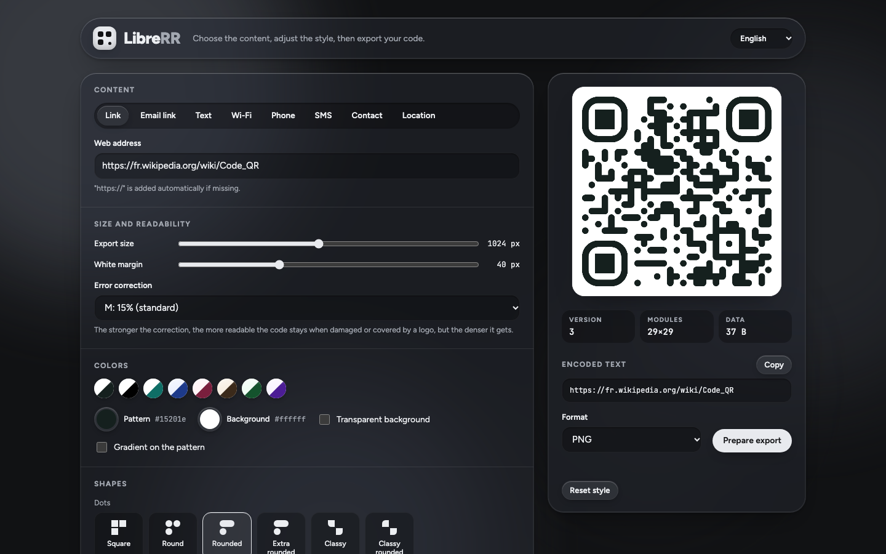
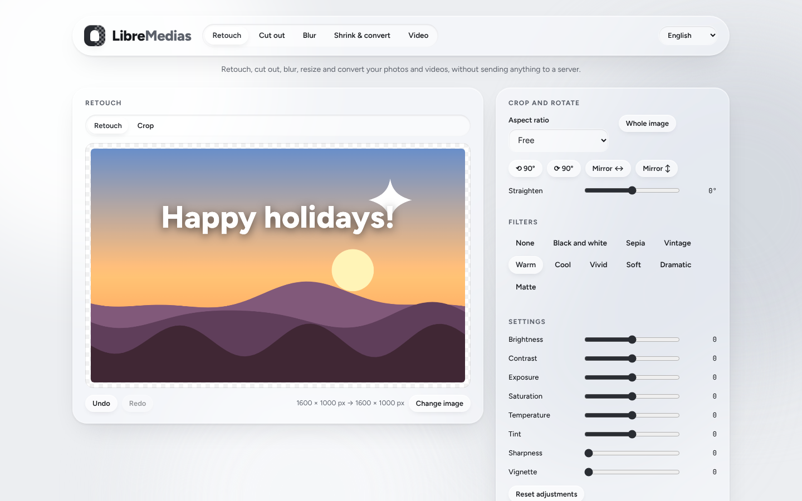
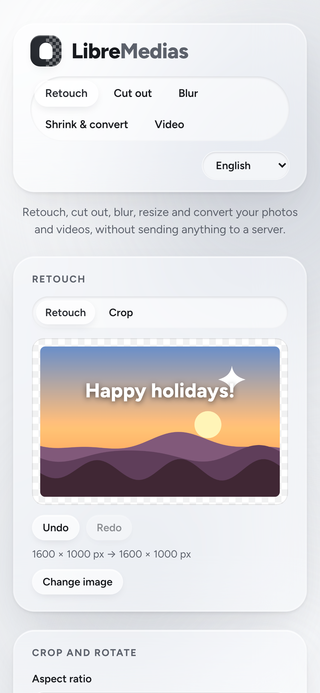

<p align="center"></p>

<h1 align="center">Suite Libre</h1>

<p align="center"><b>Fünf Alltagswerkzeuge im Browser, ohne Konto und ohne Tracking: QR-Codes, Fotos und Videos (Bearbeiten, Freistellen, Verpixeln, Größe, Umwandeln), Umrechnungen, Noten, Passwörter.</b></p>

<p align="center"> <a href="https://github.com/jeremdevgit/suite-libre/releases"></a> <a href="LICENSE"></a></p>

<p align="center"><a href="README.md">English</a> · <a href="README.fr.md">Français</a> · <a href="README.es.md">Español</a> · <b>Deutsch</b> · <a href="README.it.md">Italiano</a> · <a href="README.pt.md">Português</a> · <a href="README.zh.md">简体中文</a> · <a href="README.ja.md">日本語</a></p>

<p align="center"><a href="https://jeremdevgit.github.io/suite-libre/"><b>▶ Im Browser öffnen</b></a> · <a href="https://github.com/jeremdevgit/suite-libre/releases/latest">Herunterladen</a></p>


Jedes Werkzeug läuft **vollständig in deinem Browser**: Nichts wird an einen Server gesendet. Jedes gibt es auch als **Offline-Version**, eine einzelne HTML-Datei, die sich per Doppelklick unter Windows, macOS, Linux, Android oder auf dem iPhone öffnet.

## Auf einen Blick

| | |
|---|---|
| **Kategorie** | 📒 Produktivität & Daten |
| **Plattformen** | Browser |
| **Oberfläche** | 8 Sprachen (EN, FR, ES, DE, IT, PT, ZH, JA) |
| **Preis** | Kostenlos, quelloffen, ohne Werbung und Telemetrie |
| **Status** | Stabil |
| **Lizenz** | [GPL-3.0-or-later](LICENSE) |

## Die Werkzeuge

| Werkzeug | Wofür |
|---|---|
| **LibreRR** | QR-Codes für Links, E-Mail, Text, WLAN, Telefon, SMS, Visitenkarten oder Orte; Farben, Verläufe, Formen, Logo; Export als PNG, SVG, JPEG oder WEBP |
| **LibreMedias** | Das All-in-one-Werkzeug für Fotos und Videos. **Bearbeiten**: zuschneiden, drehen, ausrichten, spiegeln, Licht/Kontrast/Farbe/Schärfe, Filter, Text, Piktogramm-Bibliothek und eigene Logos, Wasserzeichen, Größe in Pixeln. **Freistellen**: JPEG zu transparentem PNG, automatisches Motiv, Rahmen, einfarbiger oder Greenscreen-Hintergrund, Pinsel und Zauberstab, neuer Hintergrund, Schatten, Sticker-Umriss, Stapel als ZIP. **Verpixeln** von Gesichtern, Kennzeichen und Dokumenten. **Verkleinern und umwandeln** im Stapel. **Video**: Greenscreen oder feste Kamera, Zuschnitt, Größe in px, Anfang und Ende, WEBM/MP4, animiertes GIF oder PNG/JPEG-Folge. Export als PNG, JPEG, WEBP, AVIF, GIF, BMP, TIFF, ICO, PDF; **immer ohne** Ort, Kamera und Datum |
| **LibreConvert** | Einheiten, Tage zwischen Daten (mit französischen Feiertagen), Zeitzonen, Dezimal/Binär/Oktal/Hex |
| **LibreNotes** | Fach- und Gesamtdurchschnitt mit Gewichtung (französische Skala 0–20), nötige Note für ein Ziel, CSV-Export |
| **LibrePass** | Echt zufällige Passwörter oder merkbare Passphrasen und ein Stärketest für deine eigenen |

<p> </p>
<p> </p>

## Nutzen

- **Online**: <https://jeremdevgit.github.io/suite-libre/>
- **Offline**: ein Werkzeug aus der [neuesten Version](https://github.com/jeremdevgit/suite-libre/releases/latest) herunterladen (z. B. `LibreRR-hors-ligne.html`) und öffnen.
- **Prüfen**: `shasum -a 256 -c SHA256SUMS.txt --ignore-missing` (macOS/Linux) oder `Get-FileHash` (Windows).

## Deine Daten

- **Nichts verlässt dein Gerät**: kein Server, keine Cookies, keine Statistik, keine Schriften oder Skripte von anderen Seiten.
- Eine **strenge Content Security Policy (CSP)** auf jeder Seite blockiert jede externe Verbindung; in den Offline-Dateien ist jedes Skript über seinen **SHA-256-Hash** erlaubt, eine veränderte Datei läuft also nicht.
- LibrePass nutzt den kryptografischen Zufallsgenerator des Browsers (`crypto.getRandomValues`) ohne Verzerrung; LibreMedias erzeugt Bilder ohne Metadaten.

## Bauen und hosten

```sh
python3 construire.py      # Python 3.8+, ohne Abhängigkeiten → dist/ (5 Offline-Dateien + SHA256SUMS.txt)
```

Die Werkzeuge sind statische Seiten, jedes Hosting passt; für GitHub Pages *Deploy from a branch → `main` / Root* wählen. Die Texte stehen in der `textes.js` jedes Ordners, mit dem französischen Text als Schlüssel.

## Lizenz

GNU GPL v3 oder später – siehe [LICENSE](LICENSE). Enthalten: [qr-code-styling](https://github.com/kozakdenys/qr-code-styling) (MIT) sowie die Schriften [Figtree](https://github.com/erikdkennedy/figtree) und [JetBrains Mono](https://github.com/JetBrains/JetBrainsMono) (OFL 1.1), siehe [`licences-tiers/`](licences-tiers/).

---

Eine Sicherheitslücke gefunden? Bitte privat melden (siehe [SECURITY.md](SECURITY.md)), nicht in einem öffentlichen Issue.

## Weitere freie Software von jeremdevgit

Alle kostenlos, quelloffen und werbefrei.

**🛠️ System & Hardware** — [Boîte à outils](https://github.com/jeremdevgit/boite-a-outils) · [rJb](https://github.com/jeremdevgit/rjb) · [LJ Hub](https://github.com/jeremdevgit/lj-hub) · [Decklight](https://github.com/jeremdevgit/decklight)

**📒 Produktivität & Daten** — [Carnet de notes](https://github.com/jeremdevgit/carnet-rust) · [JMeca](https://github.com/jeremdevgit/jmeca)

**🎮 Musik & Spiele** — [Pomme](https://github.com/jeremdevgit/pomme) · [Ludothèque](https://github.com/jeremdevgit/ludotheque) · [AutoDex](https://github.com/jeremdevgit/autodex) · [Batailles de France](https://github.com/jeremdevgit/batailles-de-france)
