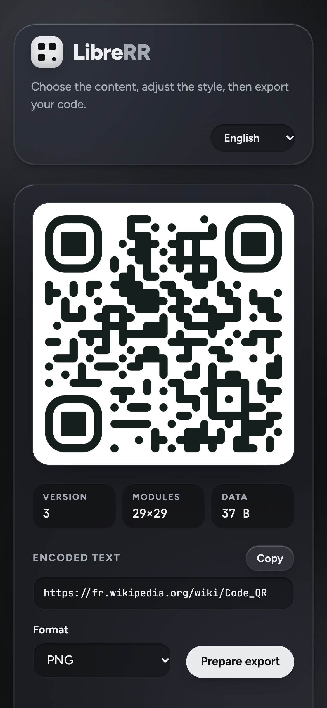
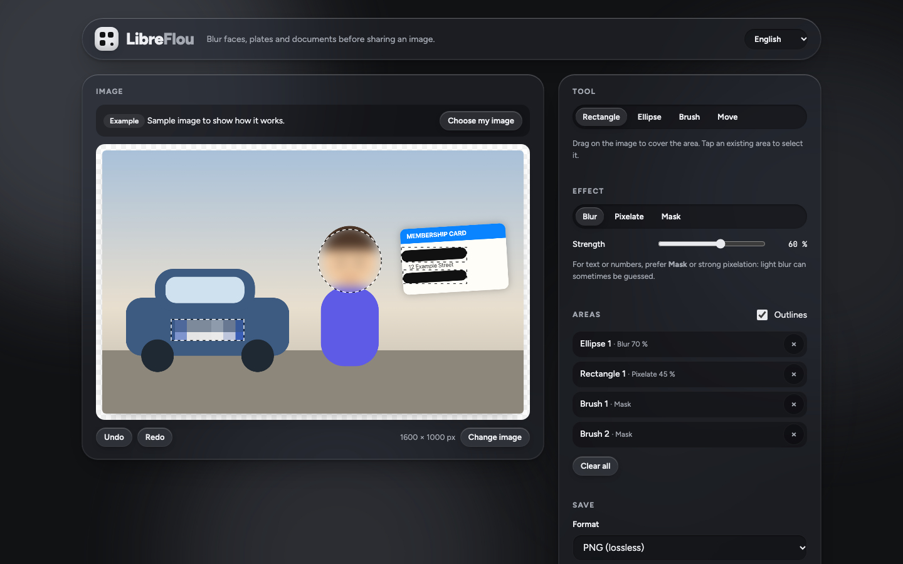
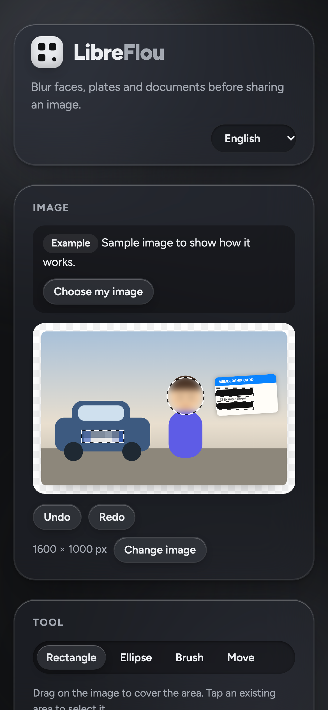

<p align="center"></p>

<h1 align="center">Suite Libre</h1>

<p align="center"><b>Seis herramientas cotidianas en el navegador, sin cuenta ni rastreo: códigos QR, desenfoque, fotos, conversiones, notas, contraseñas.</b></p>

<p align="center"> <a href="https://github.com/jeremdevgit/suite-libre/releases"></a> <a href="LICENSE"></a></p>

<p align="center"><a href="README.md">English</a> · <a href="README.fr.md">Français</a> · <b>Español</b> · <a href="README.de.md">Deutsch</a> · <a href="README.it.md">Italiano</a> · <a href="README.pt.md">Português</a> · <a href="README.zh.md">简体中文</a> · <a href="README.ja.md">日本語</a></p>

<p align="center"><a href="https://jeremdevgit.github.io/suite-libre/"><b>▶ Abrir en el navegador</b></a> · <a href="https://github.com/jeremdevgit/suite-libre/releases/latest">Descargar</a></p>


Cada herramienta funciona **por completo en tu navegador**: nada se envía a un servidor. Todas tienen también una **versión sin conexión**, un único archivo HTML que se abre con doble clic en Windows, macOS, Linux, Android o iPhone.

## De un vistazo

| | |
|---|---|
| **Categoría** | 📒 Productividad y datos |
| **Plataformas** | Navegador |
| **Interfaz** | 8 idiomas (EN, FR, ES, DE, IT, PT, ZH, JA) |
| **Precio** | Gratis, de código abierto, sin anuncios ni telemetría |
| **Estado** | Estable |
| **Licencia** | [GPL-3.0-or-later](LICENSE) |

## Las herramientas

| Herramienta | Para qué sirve |
|---|---|
| **LibreRR** | Códigos QR para enlaces, correo, texto, Wi-Fi, teléfono, SMS, tarjetas de contacto o lugares; colores, degradados, formas, logotipo; exporta PNG, SVG, JPEG o WEBP |
| **LibreFlou** | Desenfoca, pixela o tapa caras, matrículas y documentos antes de compartir; se guarda a tamaño real **sin GPS ni datos ocultos** |
| **LibreImage** | Reduce fotos (JPEG, WEBP, PNG), las redimensiona y **siempre elimina** ubicación, cámara y fecha; una a una o en ZIP |
| **LibreConvert** | Unidades, días entre fechas (con festivos franceses), zonas horarias, decimal/binario/octal/hexadecimal |
| **LibreNotes** | Medias por asignatura y general con coeficientes (escala francesa 0–20), nota necesaria para un objetivo, exportación CSV |
| **LibrePass** | Contraseñas realmente aleatorias o frases fáciles de recordar, y prueba de robustez de las tuyas |

<p> </p>
<p> </p>

## Usar

- **En línea**: <https://jeremdevgit.github.io/suite-libre/>
- **Sin conexión**: descarga una herramienta de la [última versión](https://github.com/jeremdevgit/suite-libre/releases/latest) (por ejemplo `LibreRR-hors-ligne.html`) y ábrela.
- **Verificar** una descarga: `shasum -a 256 -c SHA256SUMS.txt --ignore-missing` (macOS/Linux) o `Get-FileHash` (Windows).

## Tus datos

- **Nada sale de tu dispositivo**: sin servidor, cookies, estadísticas, ni fuentes o scripts de otros sitios.
- Una **política de seguridad de contenido (CSP) estricta** en cada página bloquea cualquier conexión externa; en los archivos sin conexión cada script se autoriza por su **hash SHA-256**, así que un archivo modificado no se ejecuta.
- LibrePass usa el generador criptográfico del navegador (`crypto.getRandomValues`) sin sesgo; LibreImage y LibreFlou generan imágenes sin metadatos.

## Compilar y alojar

```sh
python3 construire.py      # Python 3.8+, sin dependencias → dist/ (6 archivos sin conexión + SHA256SUMS.txt)
```

Las herramientas son páginas estáticas, así que sirve cualquier alojamiento; para GitHub Pages elige *Deploy from a branch → `main` / raíz*. Los textos están en el `textes.js` de cada carpeta, con el texto francés como clave.

## Licencia

GNU GPL v3 o posterior — ver [LICENSE](LICENSE). Incluye [qr-code-styling](https://github.com/kozakdenys/qr-code-styling) (MIT) y las fuentes [Figtree](https://github.com/erikdkennedy/figtree) y [JetBrains Mono](https://github.com/JetBrains/JetBrainsMono) (OFL 1.1), ver [`licences-tiers/`](licences-tiers/).

---

¿Has encontrado una vulnerabilidad? Infórmala en privado (consulta [SECURITY.md](SECURITY.md)) y no en una incidencia pública.

## Más software libre de jeremdevgit

Todos gratuitos, de código abierto y sin anuncios.

**🛠️ Sistema y hardware** — [Boîte à outils](https://github.com/jeremdevgit/boite-a-outils) · [rJb](https://github.com/jeremdevgit/rjb) · [LJ Hub](https://github.com/jeremdevgit/lj-hub) · [Decklight](https://github.com/jeremdevgit/decklight)

**📒 Productividad y datos** — [Carnet de notes](https://github.com/jeremdevgit/carnet-rust) · [JMeca](https://github.com/jeremdevgit/jmeca)

**🎮 Música y juegos** — [Pomme](https://github.com/jeremdevgit/pomme) · [Ludothèque](https://github.com/jeremdevgit/ludotheque) · [AutoDex](https://github.com/jeremdevgit/autodex) · [Batailles de France](https://github.com/jeremdevgit/batailles-de-france)
