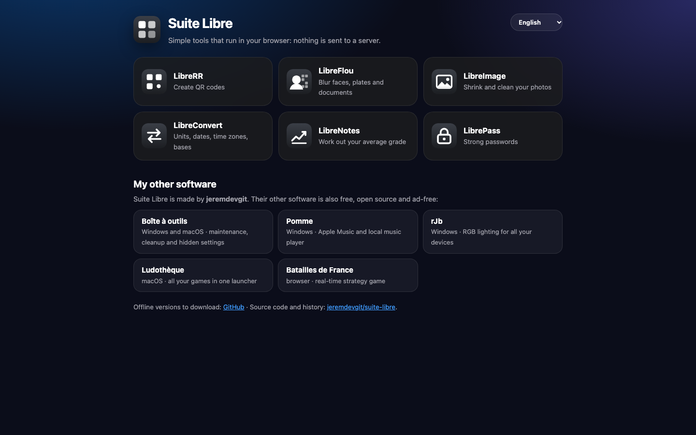
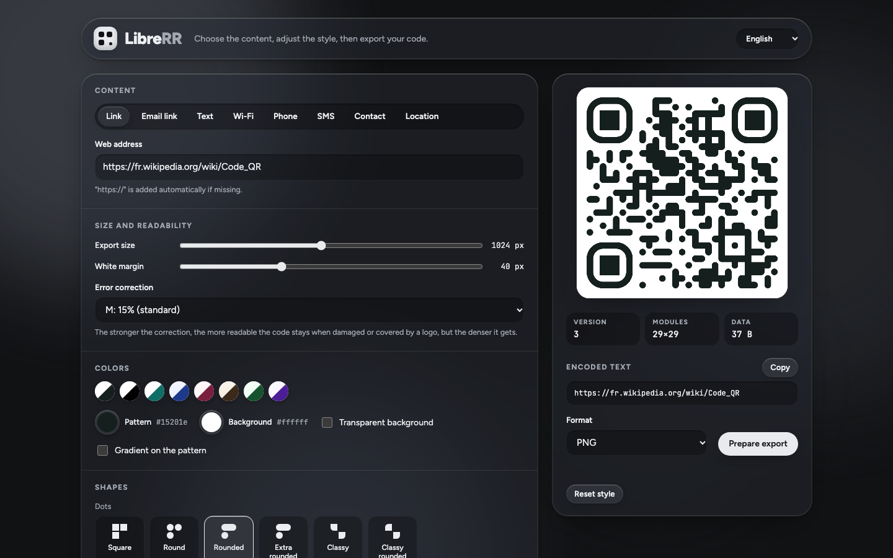
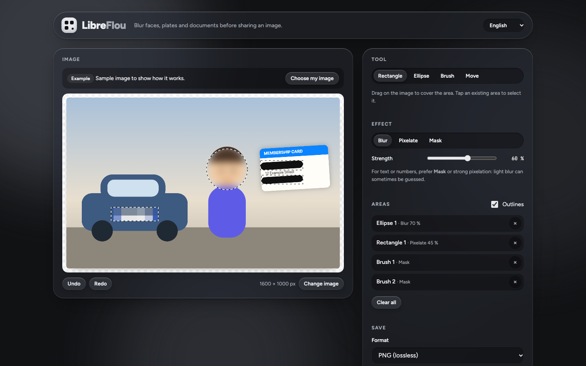

# Suite Libre

[English](README.md) · [Français](README.fr.md) · **Español**

**Seis herramientas del día a día que funcionan por completo en tu navegador.** Sin cuenta, sin publicidad, sin rastreo: no se envía nada a ningún servidor. Cada herramienta existe también en **versión sin conexión**, un solo archivo HTML que se abre con doble clic.

**8 idiomas**: español, inglés, francés, alemán, italiano, portugués, chino y japonés. El idioma del navegador se elige automáticamente; el menú de la parte superior de cada página permite cambiarlo.



| Herramienta | Para qué sirve |
|---|---|
| **LibreRR** | Crear códigos QR personalizados |
| **LibreFlou** | Difuminar caras, matrículas y documentos antes de compartir |
| **LibreImage** | Aligerar fotos y quitarles la información oculta |
| **LibreConvert** | Unidades, fechas, husos horarios, bases numéricas |
| **LibreNotes** | Calcular tu media y la nota que necesitas para aprobar |
| **LibrePass** | Generar contraseñas seguras y comprobar las tuyas |

## Usar las herramientas

**En línea**: <https://jeremdevgit.github.io/suite-libre/>

**Sin conexión**: descarga el archivo de la herramienta que quieras en la página [Releases](https://github.com/jeremdevgit/suite-libre/releases/latest) (por ejemplo `LibreRR-hors-ligne.html`) y ábrelo en tu navegador. Funciona sin conexión en Windows, macOS, Linux, Android e iPhone.

Para comprobar que un archivo descargado no ha sido modificado, compara su suma con `SHA256SUMS.txt` (publicado con cada versión):

```sh
# macOS / Linux
shasum -a 256 -c SHA256SUMS.txt --ignore-missing
# Windows (PowerShell)
Get-FileHash .\LibreRR-hors-ligne.html -Algorithm SHA256
```

## Las herramientas

- **LibreRR**: código QR para un enlace, un correo prellenado, un texto, una red Wi-Fi, un teléfono, un SMS, una ficha de contacto o un lugar. Colores, degradado, formas, logotipo en el centro; exportación PNG, SVG, JPEG o WEBP.
- **LibreFlou**: rectángulos, elipses o pincel con desenfoque, píxeles o máscara. La imagen se guarda a su tamaño original, **sin ubicación GPS ni otros datos ocultos**.
- **LibreImage**: comprime y redimensiona tus imágenes y **siempre elimina** los datos ocultos (ubicación GPS, cámara, fecha). Descarga imagen por imagen o en ZIP.
- **LibreConvert**: longitudes, masas, temperaturas, volúmenes, superficies, velocidades, datos, duraciones, energía y presión; diferencia entre fechas con festivos franceses; hora en varios husos; conversión decimal, binario, octal y hexadecimal.
- **LibreNotes**: medias ponderadas por asignatura y evaluación (escala francesa sobre 20) y la nota necesaria para alcanzar tu objetivo. Exportación CSV.
- **LibrePass**: contraseñas realmente aleatorias o frases de contraseña fáciles de recordar; prueba la solidez de las tuyas. Nada se envía ni se guarda.

<p> </p>

## Privacidad y seguridad

- **Ningún dato sale de tu dispositivo.** Sin servidor de aplicación, sin cookies, sin estadísticas, sin recursos cargados desde otro sitio.
- **Política de seguridad estricta (CSP)** en cada página; en las versiones sin conexión, cada script se autoriza por su **suma SHA-256**.
- **LibreImage y LibreFlou** producen imágenes sin metadatos.

¿Una vulnerabilidad? Lee [SECURITY.md](SECURITY.md) antes de abrir una incidencia pública.

## Construir las versiones sin conexión

```sh
python3 construire.py
```

Basta con Python 3.8 o posterior, sin dependencias. Las traducciones están en el archivo `textes.js` de cada carpeta, con el texto francés como clave.

## Licencia

Código bajo licencia **GNU GPL v3 o posterior**: ver [LICENSE](LICENSE). Copyright © 2026 jeremdevgit. Componentes de terceros (qr-code-styling, MIT; fuentes Figtree y JetBrains Mono, SIL OFL 1.1) en la carpeta [licences-tiers](licences-tiers/).

## Mis otros programas

Todos libres, gratuitos y sin publicidad: [github.com/jeremdevgit](https://github.com/jeremdevgit)

| Programa | Para | En breve |
|---|---|---|
| [JMeca](https://github.com/jeremdevgit/jmeca) | Windows, macOS, Linux | mantenimiento de vehículos cifrado, carpetas de clientes, historial y consumo |
| [Boîte à outils](https://github.com/jeremdevgit/boite-a-outils) | Windows, macOS | mantenimiento, limpieza y ajustes ocultos |
| [Pomme](https://github.com/jeremdevgit/pomme) | Windows | reproductor de Apple Music y música local |
| [rJb](https://github.com/jeremdevgit/rjb) | Windows | la iluminación RGB de todos tus dispositivos |
| [Ludothèque](https://github.com/jeremdevgit/ludotheque) | macOS | todos tus juegos en un solo lanzador |
| [Batailles de France](https://github.com/jeremdevgit/batailles-de-france) | navegador | juego de estrategia en tiempo real sobre cinco ciudades francesas |
