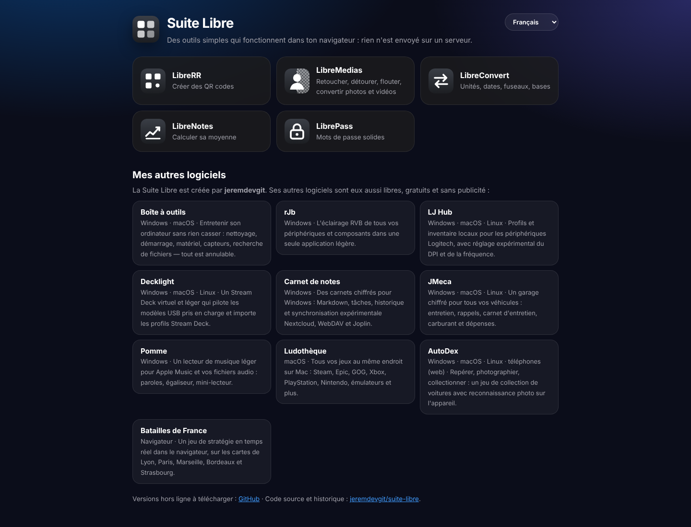
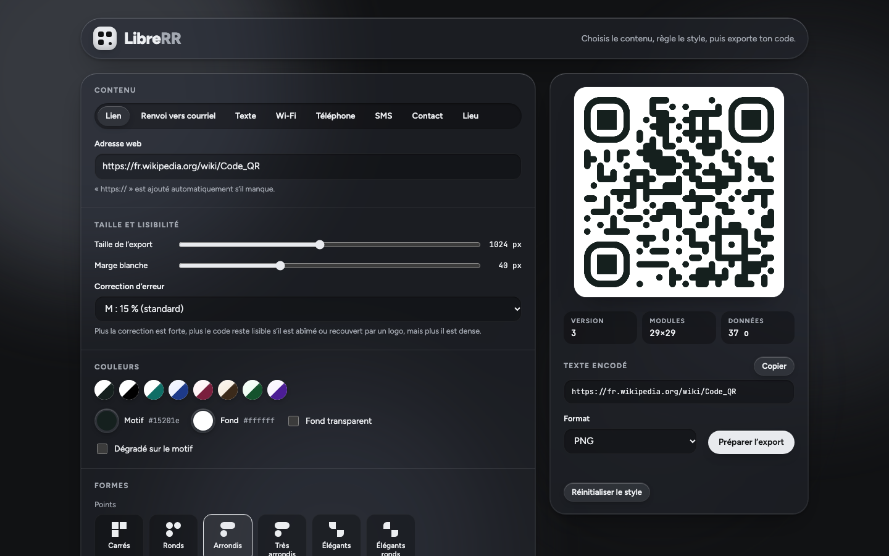
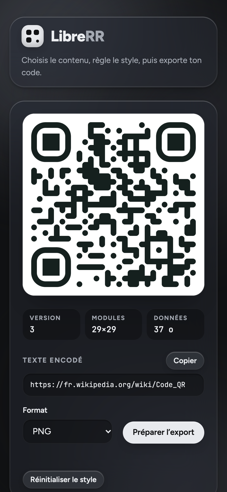
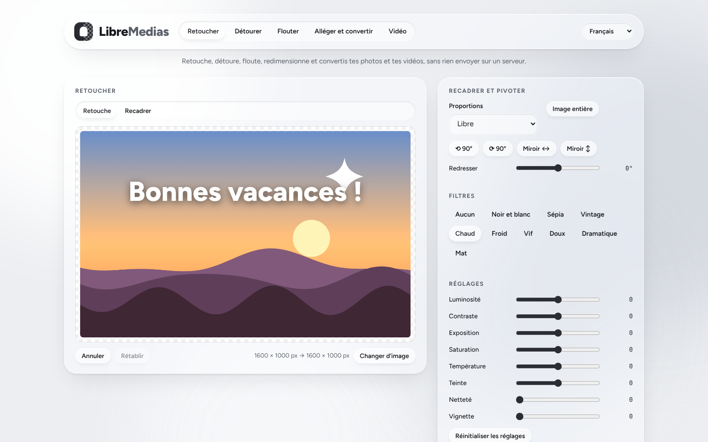
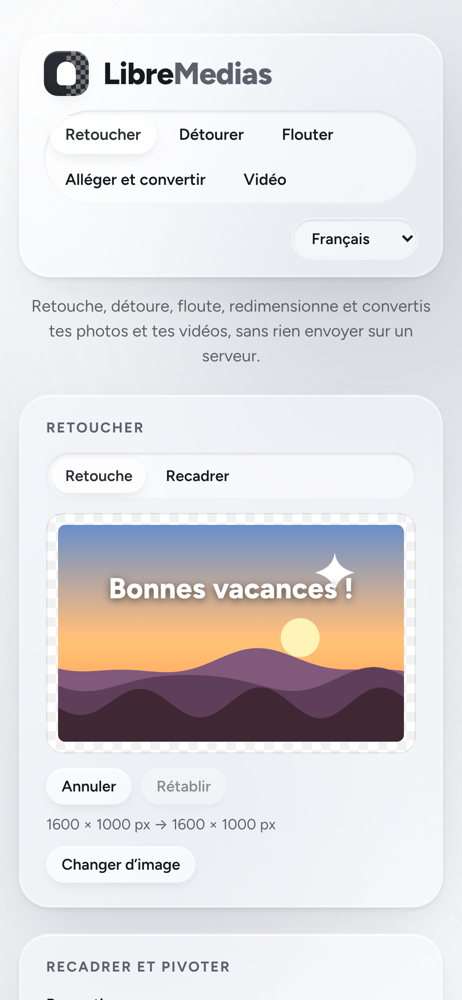

<p align="center"></p>

<h1 align="center">Suite Libre</h1>

<p align="center"><b>Cinq outils du quotidien dans le navigateur, sans compte ni pistage : QR codes, photos et vidéos (retouche, détourage, floutage, dimensions, conversion), conversions, moyennes, mots de passe.</b></p>

<p align="center"> <a href="https://github.com/jeremdevgit/suite-libre/releases"></a> <a href="LICENSE"></a></p>

<p align="center"><a href="README.md">English</a> · <b>Français</b> · <a href="README.es.md">Español</a> · <a href="README.de.md">Deutsch</a> · <a href="README.it.md">Italiano</a> · <a href="README.pt.md">Português</a> · <a href="README.zh.md">简体中文</a> · <a href="README.ja.md">日本語</a></p>

<p align="center"><a href="https://jeremdevgit.github.io/suite-libre/"><b>▶ Ouvrir dans le navigateur</b></a> · <a href="https://github.com/jeremdevgit/suite-libre/releases/latest">Télécharger</a></p>



Chaque outil fonctionne **entièrement dans votre navigateur** : rien n'est envoyé à un serveur. Chacun existe aussi en **version hors ligne**, un simple fichier HTML qui s'ouvre d'un double-clic sous Windows, macOS, Linux, Android ou iPhone.

## En bref

| | |
|---|---|
| **Catégorie** | 📒 Productivité et données |
| **Plateformes** | Navigateur |
| **Interface** | 8 langues (EN, FR, ES, DE, IT, PT, ZH, JA) |
| **Prix** | Gratuit, open source, sans publicité ni télémétrie |
| **État** | Stable |
| **Licence** | [GPL-3.0-or-later](LICENSE) |

## Les outils

| Outil | À quoi il sert |
|---|---|
| **LibreRR** | QR codes pour un lien, un e-mail, du texte, un Wi-Fi, un téléphone, un SMS, une fiche contact ou un lieu ; couleurs, dégradés, formes, logo ; export PNG, SVG, JPEG ou WEBP |
| **LibreMedias** | L’outil photo et vidéo tout-en-un. **Retoucher** : recadrer, pivoter, redresser, retourner, lumière/contraste/couleurs/netteté, filtres, texte, bibliothèque de pictogrammes et tes propres logos, filigrane, taille en pixels. **Détourer** : JPEG en PNG transparent, sujet automatique, cadre, fond uni ou vert, pinceau et baguette, nouveau fond, ombre, contour autocollant, lot en ZIP. **Flouter** visages, plaques et documents. **Alléger et convertir** des images par lots. **Vidéo** : fond vert ou caméra fixe, recadrage, taille en px, début et fin, WEBM/MP4, GIF animé ou suite PNG/JPEG. Export en PNG, JPEG, WEBP, AVIF, GIF, BMP, TIFF, ICO, PDF ; **toujours sans** lieu, appareil ni date |
| **LibreConvert** | Unités, jours entre deux dates (avec jours fériés français), fuseaux horaires, décimal/binaire/octal/hexadécimal |
| **LibreNotes** | Moyennes par matière et générale avec coefficients (sur 20), note nécessaire pour atteindre un objectif, export CSV |
| **LibrePass** | Mots de passe vraiment aléatoires ou phrases faciles à retenir, et test de robustesse des vôtres |

<p> </p>
<p> </p>

## Utiliser

- **En ligne** : <https://jeremdevgit.github.io/suite-libre/>
- **Hors ligne** : téléchargez un outil depuis la [dernière version](https://github.com/jeremdevgit/suite-libre/releases/latest) (par exemple `LibreRR-hors-ligne.html`) et ouvrez-le.
- **Vérifier** un téléchargement : `shasum -a 256 -c SHA256SUMS.txt --ignore-missing` (macOS/Linux) ou `Get-FileHash` (Windows).

## Vos données

- **Rien ne quitte votre appareil** : ni serveur, ni cookies, ni statistiques, ni polices ou scripts venus d'un autre site.
- Une **politique de sécurité du contenu (CSP) stricte** sur chaque page bloque toute connexion extérieure ; dans les fichiers hors ligne, chaque script est autorisé par son **empreinte SHA-256**, donc un fichier modifié refuse de s'exécuter.
- LibrePass utilise le générateur cryptographique du navigateur (`crypto.getRandomValues`) sans biais ; LibreMedias produit des images sans métadonnées.

## Construire et héberger

```sh
python3 construire.py      # Python 3.8+, sans dépendance → dist/ (5 fichiers hors ligne + SHA256SUMS.txt)
```

Les outils sont des pages statiques : n'importe quel hébergement convient ; pour GitHub Pages, choisissez *Deploy from a branch → `main` / racine*. Les textes sont dans le `textes.js` de chaque dossier, avec le texte français comme clé.

## Licence

GNU GPL v3 ou ultérieure — voir [LICENSE](LICENSE). Composants inclus : [qr-code-styling](https://github.com/kozakdenys/qr-code-styling) (MIT) et les polices [Figtree](https://github.com/erikdkennedy/figtree) et [JetBrains Mono](https://github.com/JetBrains/JetBrainsMono) (OFL 1.1), voir [`licences-tiers/`](licences-tiers/).

---

Une faille de sécurité ? Signalez-la en privé (voir [SECURITY.md](SECURITY.md)) plutôt que dans un ticket public.

## Mes autres logiciels libres

Tous gratuits, open source et sans publicité.

**🛠️ Système et matériel** — [Boîte à outils](https://github.com/jeremdevgit/boite-a-outils) · [rJb](https://github.com/jeremdevgit/rjb) · [LJ Hub](https://github.com/jeremdevgit/lj-hub) · [Decklight](https://github.com/jeremdevgit/decklight)

**📒 Productivité et données** — [Carnet de notes](https://github.com/jeremdevgit/carnet-rust) · [JMeca](https://github.com/jeremdevgit/jmeca)

**🎮 Musique et jeux** — [Pomme](https://github.com/jeremdevgit/pomme) · [Ludothèque](https://github.com/jeremdevgit/ludotheque) · [AutoDex](https://github.com/jeremdevgit/autodex) · [Batailles de France](https://github.com/jeremdevgit/batailles-de-france)
