# Suite Libre

[English](README.md) · **Français** · [Español](README.es.md)

**Six outils du quotidien qui fonctionnent entièrement dans ton navigateur.** Pas de compte, pas de publicité, pas de pistage : rien n'est envoyé sur un serveur. Chaque outil existe aussi en **version hors ligne**, un seul fichier HTML à ouvrir d'un double-clic.

**8 langues** : français, anglais, espagnol, allemand, italien, portugais, chinois et japonais. La langue du navigateur est choisie automatiquement ; le menu en haut de chaque page permet d'en changer.

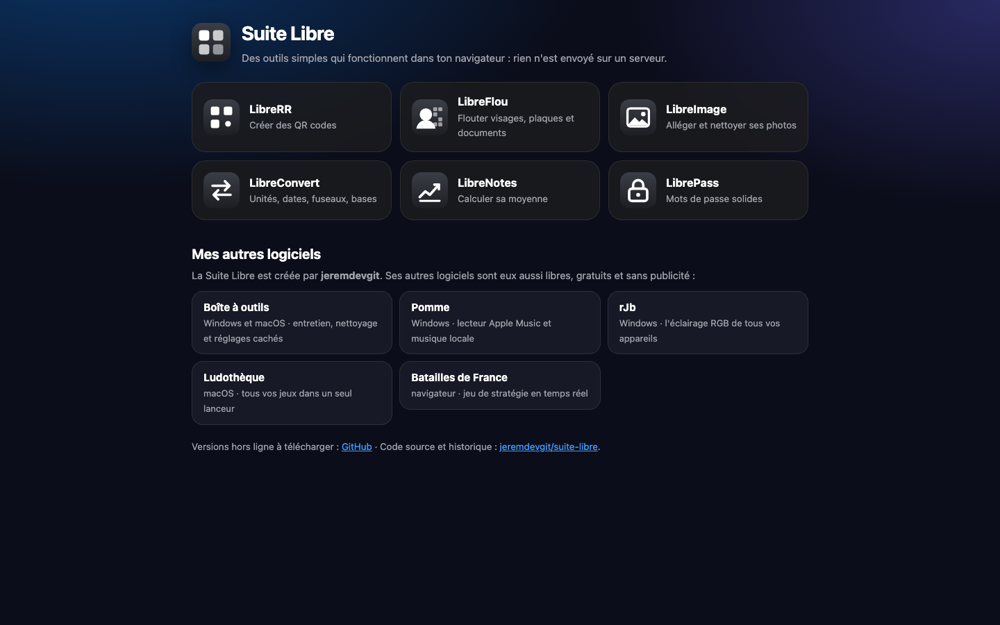

| Outil | À quoi il sert |
|---|---|
| [**LibreRR**](#librerr--qr-codes) | Créer des QR codes personnalisés |
| [**LibreFlou**](#libreflou--flouter-avant-de-partager) | Flouter visages, plaques et documents avant de partager |
| [**LibreImage**](#libreimage--alléger-et-nettoyer-ses-photos) | Alléger ses photos et retirer leurs informations cachées |
| [**LibreConvert**](#libreconvert--conversions) | Unités, dates, fuseaux horaires, bases numériques |
| [**LibreNotes**](#librenotes--calcul-de-moyenne) | Calculer sa moyenne et la note qu'il faut pour valider |
| [**LibrePass**](#librepass--mots-de-passe) | Générer des mots de passe solides et tester les siens |

---

## Utiliser les outils

**En ligne** : <https://jeremdevgit.github.io/suite-libre/>

**Hors ligne** : télécharge le fichier de l'outil voulu dans la page [Releases](https://github.com/jeremdevgit/suite-libre/releases/latest) (par exemple `LibreRR-hors-ligne.html`), puis ouvre-le dans ton navigateur. Il fonctionne sans connexion, sur Windows, macOS, Linux, Android et iPhone.

Pour vérifier qu'un fichier téléchargé n'a pas été modifié, compare son empreinte avec `SHA256SUMS.txt` (publié avec chaque version) :

```sh
# macOS / Linux
shasum -a 256 -c SHA256SUMS.txt --ignore-missing
# Windows (PowerShell)
Get-FileHash .\LibreRR-hors-ligne.html -Algorithm SHA256
```

---

## Les outils

### LibreRR — QR codes

Un QR code pour un lien, un mail pré-rempli, un texte, un réseau Wi-Fi, un numéro de téléphone, un SMS, une fiche contact ou un lieu. Taille, marge et correction d'erreur réglables ; couleurs, dégradé, forme des points et des coins, logo au centre ; export en PNG, SVG, JPEG ou WEBP. Des conseils s'affichent si le code risque d'être difficile à lire.

<p>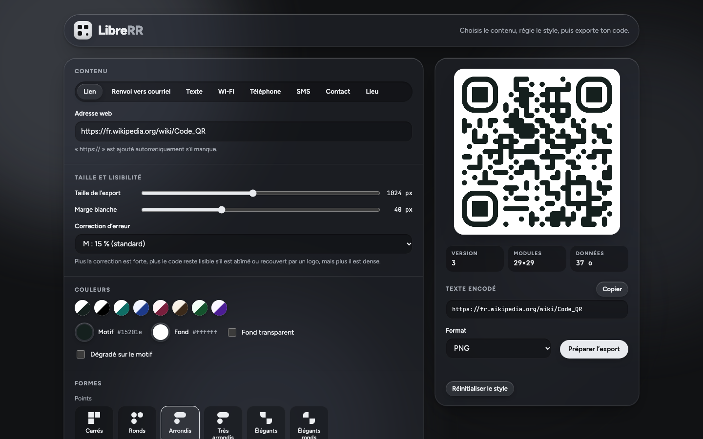 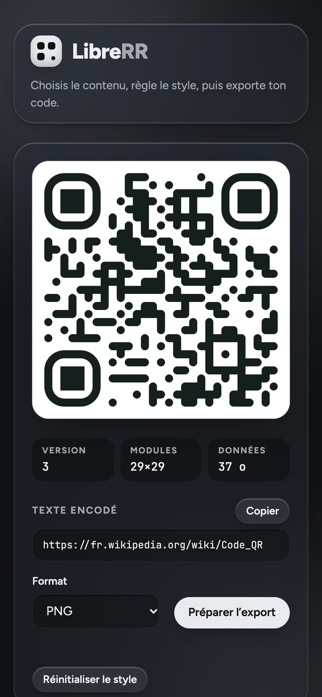</p>

### LibreFlou — flouter avant de partager

Cache ce qui ne doit pas être vu sur une photo ou une capture d'écran : visages, plaques d'immatriculation, adresses, numéros de documents. Rectangles, ellipses ou pinceau, avec pour chaque zone un effet flou, pixels ou masque opaque. Les zones se déplacent, se redimensionnent et s'annulent. L'image est enregistrée à sa taille d'origine, **sans la position GPS ni les autres informations cachées**.

<p>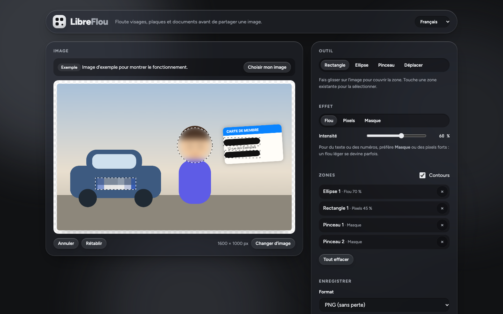 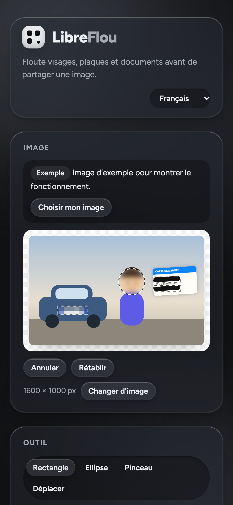</p>

### LibreImage — alléger et nettoyer ses photos

Glisse tes images : LibreImage les allège (JPEG, WEBP ou PNG, qualité réglable), les redimensionne si besoin et **retire toujours** les informations cachées (position GPS, appareil, date de prise de vue). Le gain de poids et les informations retirées sont affichés pour chaque image ; téléchargement image par image ou en ZIP.

<p>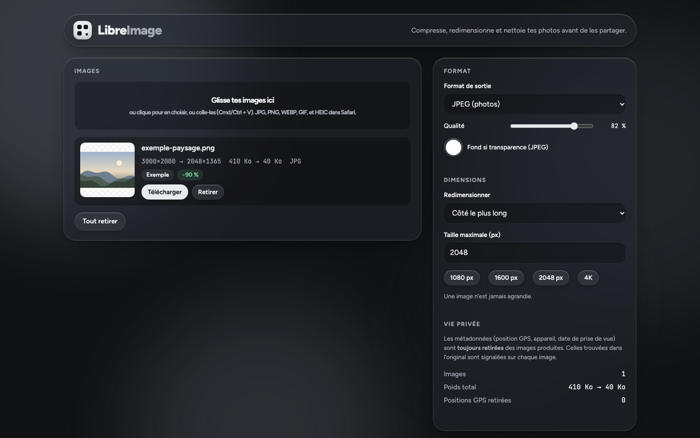 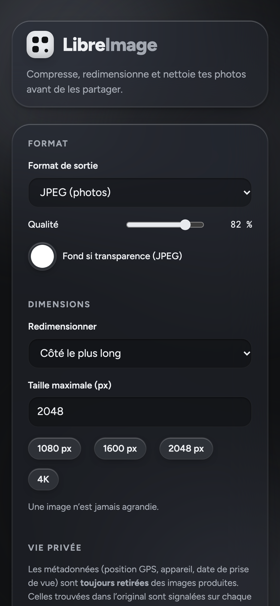</p>

### LibreConvert — conversions

Longueurs, masses, températures, volumes, surfaces, vitesses, données informatiques, durées, énergie et pression. Écart entre deux dates en jours, semaines et jours ouvrés avec les jours fériés français (Alsace-Moselle en option), ajout ou retrait de jours, semaines ou mois, heure dans plusieurs fuseaux avec les changements d'heure, conversion entre décimal, binaire, octal et hexadécimal.

<p>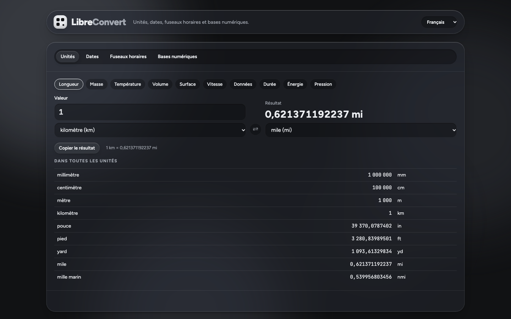 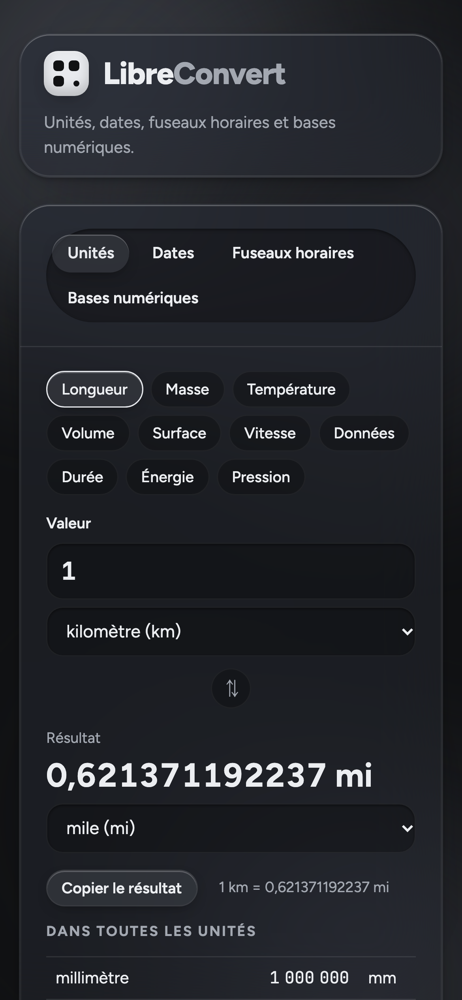</p>

### LibreNotes — calcul de moyenne

Ajoute tes matières et tes évaluations avec leurs coefficients : LibreNotes calcule la moyenne de chaque matière, la moyenne générale et la mention. Laisse vides les évaluations à venir : il indique la note à obtenir pour atteindre la moyenne visée. Export en CSV. Les notes restent dans ton navigateur.

<p>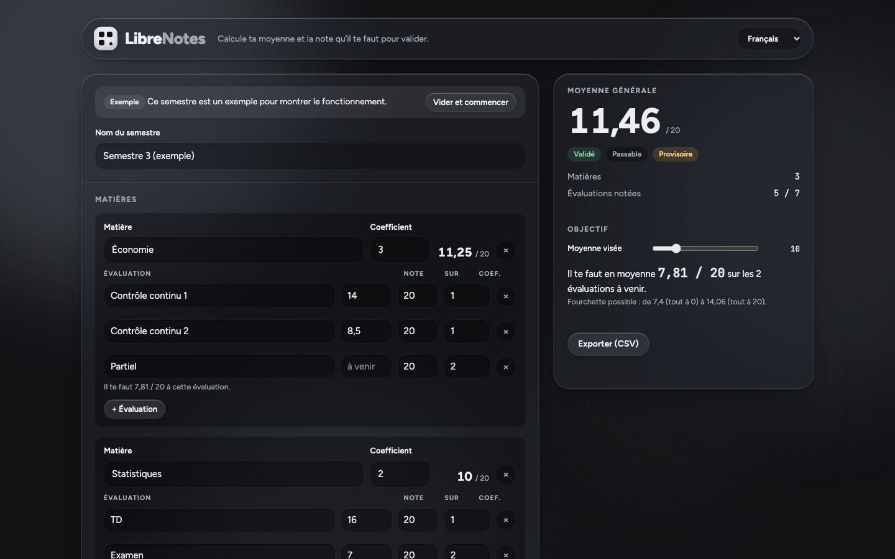 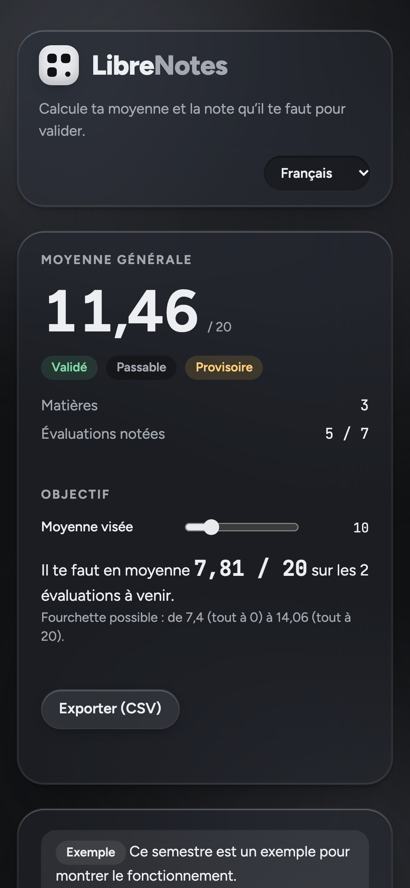</p>

### LibrePass — mots de passe

Génère des mots de passe vraiment aléatoires (longueur, majuscules, chiffres, symboles, caractères ambigus évités) ou des phrases de passe faciles à retenir (mots français, ou anglais dans les autres langues). Teste aussi tes propres mots de passe : solidité estimée, temps pour les deviner et conseils. Rien n'est envoyé ni enregistré.

<p>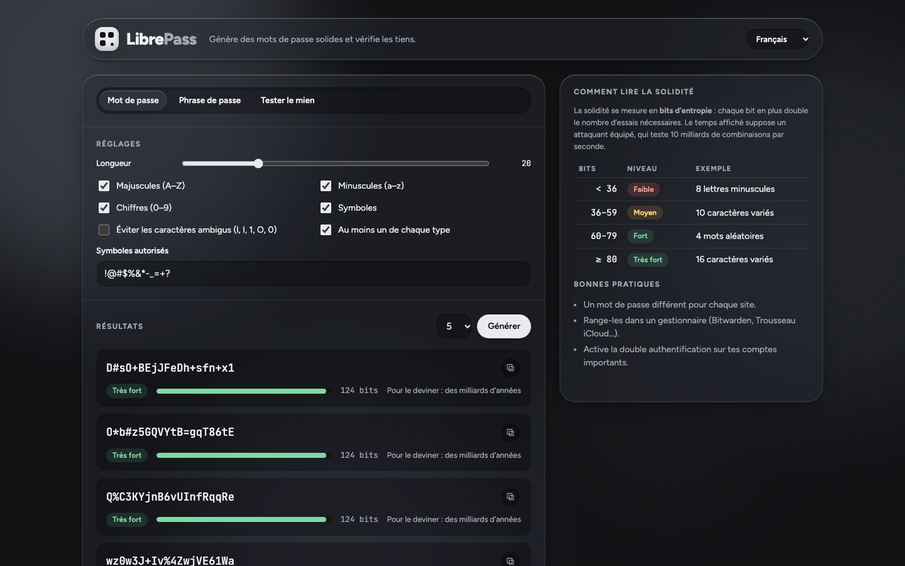 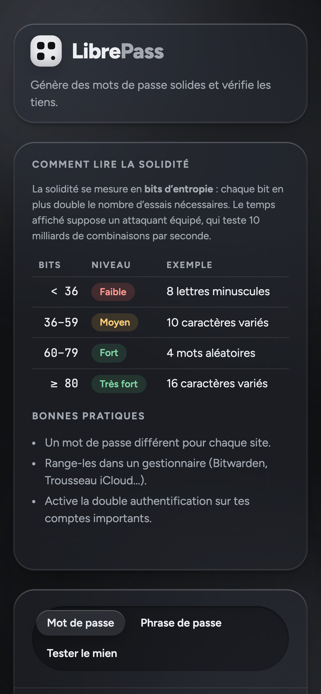</p>

---

## Vie privée et sécurité

- **Aucune donnée ne quitte ton appareil.** Pas de serveur applicatif, pas de cookie, pas de statistiques, pas de police ni de script chargé depuis un autre site.
- **Politique de sécurité stricte (CSP)** dans chaque page : seuls les scripts de l'outil peuvent s'exécuter, et aucune connexion réseau n'est autorisée en dehors du site lui-même. Dans les versions hors ligne, chaque script est autorisé par son **empreinte SHA-256** : un fichier modifié refuse de s'exécuter.
- **LibrePass** tire ses caractères avec le générateur cryptographique du navigateur (`crypto.getRandomValues`), par tirage sans biais.
- **LibreImage et LibreFlou** produisent des images sans métadonnées (position GPS, appareil, date).
- Tout texte affiché dans la page est échappé : un nom de fichier ou une saisie ne peut pas injecter de code.

Une faille ? Merci de lire [SECURITY.md](SECURITY.md) avant d'ouvrir un ticket public.

---

## Construire les versions hors ligne

Python 3.8 ou plus récent suffit, sans aucune dépendance :

```sh
python3 construire.py
```

Les six fichiers autonomes et `SHA256SUMS.txt` sont créés dans `dist/`. Chaque fichier embarque l'icône, les polices et les scripts de l'outil.

## Héberger la suite

Les outils sont de simples pages statiques : n'importe quel hébergement de fichiers convient. Pour **GitHub Pages** : *Settings → Pages → Build and deployment → Deploy from a branch → `main` / `(root)`*. La page d'accueil est `index.html`, chaque outil est dans son dossier.

## Structure du dépôt

```
index.html, suite.css        page d'accueil de la suite
librerr/ … librepass/        un dossier par outil (index.html, script, icône, polices)
langue.js, */textes.js       choix de la langue et traductions (le texte français sert de clé)
construire.py                construction des versions hors ligne (dist/)
captures/                    captures d'écran
licences-tiers/              licences des composants tiers
```

## Licence

Code sous licence **GNU GPL v3 ou ultérieure** — voir [LICENSE](LICENSE). Copyright © 2026 jeremdevgit.

Composants tiers inclus, sous leur propre licence (dossier [licences-tiers](licences-tiers/)) :

- [qr-code-styling](https://github.com/kozakdenys/qr-code-styling) — licence MIT (LibreRR) ;
- polices [Figtree](https://github.com/erikdkennedy/figtree) et [JetBrains Mono](https://github.com/JetBrains/JetBrainsMono) — licence SIL Open Font License 1.1.

## Mes autres logiciels

Tous libres, gratuits et sans publicité — [github.com/jeremdevgit](https://github.com/jeremdevgit) :

| Logiciel | Plateforme | En bref |
|---|---|---|
| [AutoDex](https://github.com/jeremdevgit/autodex) | Windows, macOS, Linux | Jeu de collection de voitures avec reconnaissance de photos sur l'appareil |
| [Boîte à outils](https://github.com/jeremdevgit/boite-a-outils) | Windows, macOS | Entretien de l'ordinateur, nettoyage et recherche de fichiers |
| [Carnet de notes](https://github.com/jeremdevgit/carnet-rust) | Windows | Carnets chiffrés et synchronisation expérimentale |
| [Decklight](https://github.com/jeremdevgit/decklight) | Windows, macOS, Linux | Stream Deck virtuel avec contrôle USB |
| [JMeca](https://github.com/jeremdevgit/jmeca) | Windows, macOS, Linux | Suivi d'entretien de véhicules chiffré |
| [LJ Hub](https://github.com/jeremdevgit/lj-hub) | Windows, macOS, Linux | Gestionnaire de profils pour appareils Logitech |
| [Pomme](https://github.com/jeremdevgit/pomme) | Windows | Lecteur de musique Apple Music et fichiers locaux |
| [rJb](https://github.com/jeremdevgit/rjb) | Windows | Contrôle de l'éclairage RGB |
| [Ludothèque](https://github.com/jeremdevgit/ludotheque) | macOS | Bibliothèque et lanceur de jeux |
| [Batailles de France](https://github.com/jeremdevgit/batailles-de-france) | Navigateur | Jeu de stratégie en temps réel |
