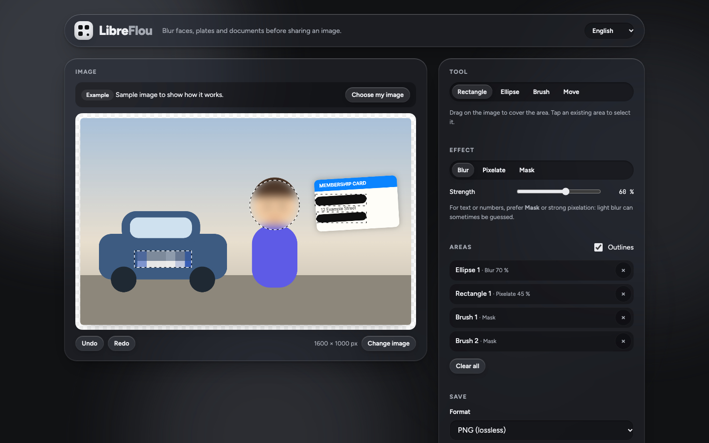
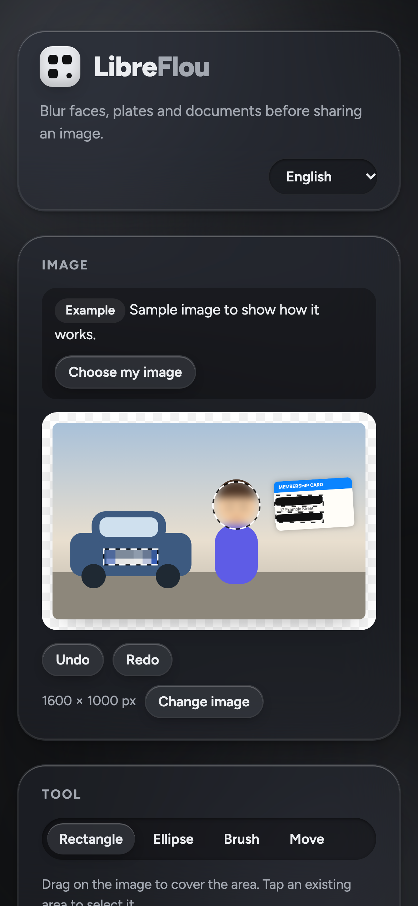
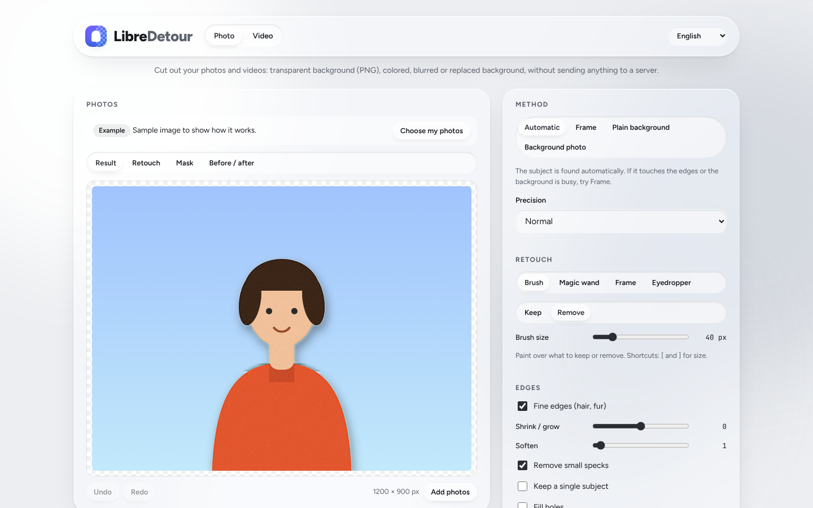
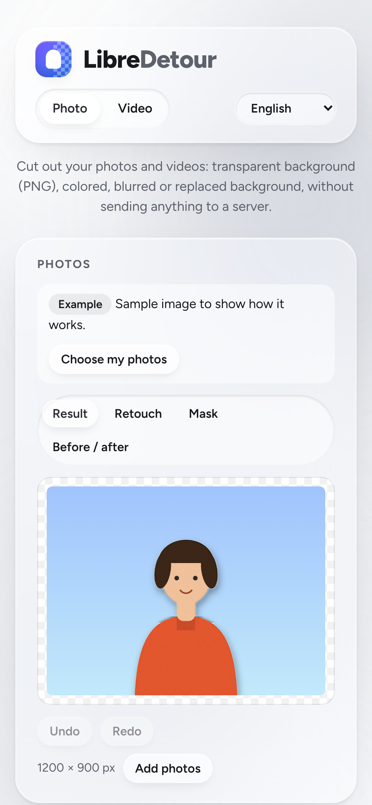

<p align="center"></p>

<h1 align="center">Suite Libre</h1>

<p align="center"><b>Sette strumenti quotidiani nel browser, senza account né tracciamento: codici QR, sfocatura, scontorno, foto, conversioni, medie, password.</b></p>

<p align="center"> <a href="https://github.com/jeremdevgit/suite-libre/releases"></a> <a href="LICENSE"></a></p>

<p align="center"><a href="README.md">English</a> · <a href="README.fr.md">Français</a> · <a href="README.es.md">Español</a> · <a href="README.de.md">Deutsch</a> · <b>Italiano</b> · <a href="README.pt.md">Português</a> · <a href="README.zh.md">简体中文</a> · <a href="README.ja.md">日本語</a></p>

<p align="center"><a href="https://jeremdevgit.github.io/suite-libre/"><b>▶ Apri nel browser</b></a> · <a href="https://github.com/jeremdevgit/suite-libre/releases/latest">Scarica</a></p>


Ogni strumento funziona **interamente nel browser**: nulla viene inviato a un server. Ognuno esiste anche in **versione offline**, un unico file HTML da aprire con un doppio clic su Windows, macOS, Linux, Android o iPhone.

## In breve

| | |
|---|---|
| **Categoria** | 📒 Produttività e dati |
| **Piattaforme** | Browser |
| **Interfaccia** | 8 lingue (EN, FR, ES, DE, IT, PT, ZH, JA) |
| **Prezzo** | Gratuito, open source, senza pubblicità né telemetria |
| **Stato** | Stabile |
| **Licenza** | [GPL-3.0-or-later](LICENSE) |

## Gli strumenti

| Strumento | A cosa serve |
|---|---|
| **LibreRR** | Codici QR per link, e-mail, testo, Wi-Fi, telefono, SMS, biglietti da visita o luoghi; colori, sfumature, forme, logo; esportazione PNG, SVG, JPEG o WEBP |
| **LibreFlou** | Sfocare, pixelare o coprire volti, targhe e documenti prima di condividere; salvato a piena risoluzione **senza GPS né dati nascosti** |
| **LibreImage** | Alleggerire le foto (JPEG, WEBP, PNG), ridimensionarle e **rimuovere sempre** posizione, fotocamera e data; singolarmente o in ZIP |
| **LibreDetour** | Togliere lo sfondo da foto e video: **da JPEG a PNG trasparente**, soggetto automatico, riquadro, sfondo uniforme o verde, o foto dello sfondo; pennello e bacchetta; nuovo sfondo (colore, sfumatura, sfocatura, bianco e nero, immagine), ombra, contorno adesivo, formato quadrato o storia; lotto in ZIP. Video: green screen o videocamera fissa (sfondo calcolato automaticamente), WEBM o sequenza PNG trasparente |
| **LibreConvert** | Unità, giorni tra due date (con festività francesi), fusi orari, decimale/binario/ottale/esadecimale |
| **LibreNotes** | Medie per materia e generale con coefficienti (scala francese 0–20), voto necessario per un obiettivo, esportazione CSV |
| **LibrePass** | Password davvero casuali o frasi facili da ricordare, e un test di robustezza per le tue |

<p> </p>
<p> </p>
<p> </p>

## Usare

- **Online**: <https://jeremdevgit.github.io/suite-libre/>
- **Offline**: scarica uno strumento dalla [versione più recente](https://github.com/jeremdevgit/suite-libre/releases/latest) (ad esempio `LibreRR-hors-ligne.html`) e aprilo.
- **Verificare** un download: `shasum -a 256 -c SHA256SUMS.txt --ignore-missing` (macOS/Linux) o `Get-FileHash` (Windows).

## I tuoi dati

- **Nulla lascia il tuo dispositivo**: niente server, cookie, statistiche, né font o script di altri siti.
- Una **Content Security Policy (CSP) rigorosa** su ogni pagina blocca qualsiasi connessione esterna; nei file offline ogni script è autorizzato dal suo **hash SHA-256**, quindi un file modificato non si avvia.
- LibrePass usa il generatore crittografico del browser (`crypto.getRandomValues`) senza distorsioni; LibreImage, LibreFlou e LibreDetour producono immagini senza metadati.

## Compilare e ospitare

```sh
python3 construire.py      # Python 3.8+, senza dipendenze → dist/ (7 file offline + SHA256SUMS.txt)
```

Gli strumenti sono pagine statiche, va bene qualsiasi hosting; per GitHub Pages scegli *Deploy from a branch → `main` / root*. I testi sono nel `textes.js` di ogni cartella, con il testo francese come chiave.

## Licenza

GNU GPL v3 o successiva — vedi [LICENSE](LICENSE). Inclusi [qr-code-styling](https://github.com/kozakdenys/qr-code-styling) (MIT) e i font [Figtree](https://github.com/erikdkennedy/figtree) e [JetBrains Mono](https://github.com/JetBrains/JetBrainsMono) (OFL 1.1), vedi [`licences-tiers/`](licences-tiers/).

---

Hai trovato una vulnerabilità? Segnalala in privato (vedi [SECURITY.md](SECURITY.md)) e non in una issue pubblica.

## Altro software libero di jeremdevgit

Tutti gratuiti, open source e senza pubblicità.

**🛠️ Sistema e hardware** — [Boîte à outils](https://github.com/jeremdevgit/boite-a-outils) · [rJb](https://github.com/jeremdevgit/rjb) · [LJ Hub](https://github.com/jeremdevgit/lj-hub) · [Decklight](https://github.com/jeremdevgit/decklight)

**📒 Produttività e dati** — [Carnet de notes](https://github.com/jeremdevgit/carnet-rust) · [JMeca](https://github.com/jeremdevgit/jmeca)

**🎮 Musica e giochi** — [Pomme](https://github.com/jeremdevgit/pomme) · [Ludothèque](https://github.com/jeremdevgit/ludotheque) · [AutoDex](https://github.com/jeremdevgit/autodex) · [Batailles de France](https://github.com/jeremdevgit/batailles-de-france)
