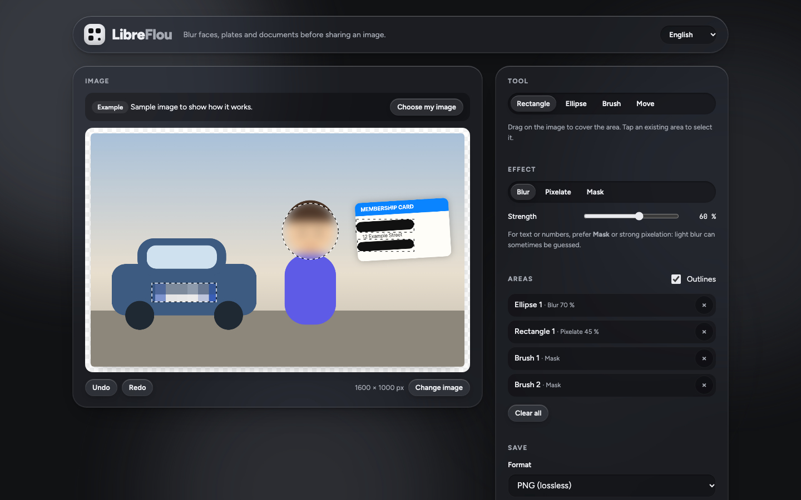
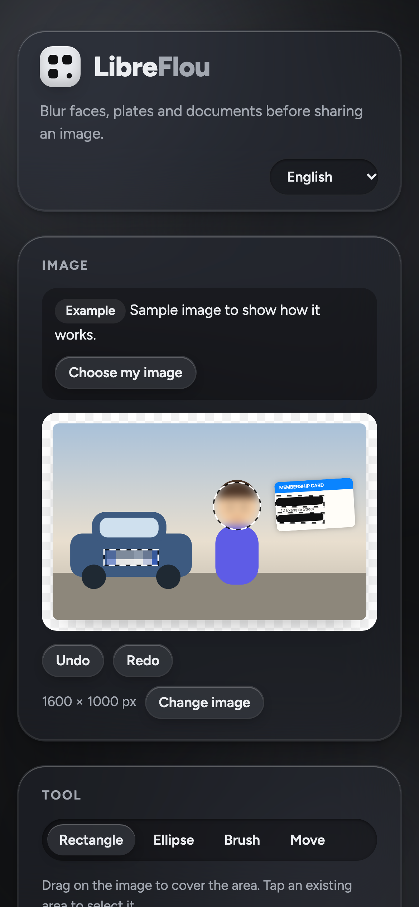

<p align="center"></p>

<h1 align="center">Suite Libre</h1>

<p align="center"><b>アカウント不要・トラッキングなしのブラウザーツール 6 種：QR コード、ぼかし、写真、単位換算、成績平均、パスワード。</b></p>

<p align="center"> <a href="https://github.com/jeremdevgit/suite-libre/releases"></a> <a href="LICENSE"></a></p>

<p align="center"><a href="README.md">English</a> · <a href="README.fr.md">Français</a> · <a href="README.es.md">Español</a> · <a href="README.de.md">Deutsch</a> · <a href="README.it.md">Italiano</a> · <a href="README.pt.md">Português</a> · <a href="README.zh.md">简体中文</a> · <b>日本語</b></p>

<p align="center"><a href="https://jeremdevgit.github.io/suite-libre/"><b>▶ ブラウザーで開く</b></a> · <a href="https://github.com/jeremdevgit/suite-libre/releases/latest">ダウンロード</a></p>


どのツールも**すべてブラウザー内で動作**し、サーバーには何も送りません。それぞれ**オフライン版**もあり、HTML ファイル 1 つをダブルクリックするだけで Windows、macOS、Linux、Android、iPhone で使えます。

## 概要

| | |
|---|---|
| **カテゴリー** | 📒 生産性とデータ |
| **対応環境** | ブラウザー |
| **表示言語** | 8 言語（英・仏・西・独・伊・葡・中・日） |
| **価格** | 無料・オープンソース・広告なし・テレメトリーなし |
| **ステータス** | 安定版 |
| **ライセンス** | [GPL-3.0-or-later](LICENSE) |

## ツール

| ツール | できること |
|---|---|
| **LibreRR** | リンク、メール、テキスト、Wi-Fi、電話、SMS、連絡先、場所の QR コード。色、グラデーション、形、ロゴ。PNG、SVG、JPEG、WEBP で書き出し |
| **LibreFlou** | 共有前に顔、ナンバープレート、書類をぼかす・モザイク・塗りつぶし。元のサイズのまま、**GPS や隠れた情報なしで**保存 |
| **LibreImage** | 写真を軽量化（JPEG、WEBP、PNG）・リサイズし、位置情報・カメラ・撮影日時を**必ず削除**。1 枚ずつ、または ZIP で |
| **LibreConvert** | 単位換算、日付間の日数（フランスの祝日対応）、タイムゾーン、10 進／2 進／8 進／16 進 |
| **LibreNotes** | 係数付きの科目別・総合平均（フランスの 20 点満点制）、目標達成に必要な点数、CSV 書き出し |
| **LibrePass** | 真にランダムなパスワードや覚えやすいパスフレーズの生成、手持ちのパスワードの強度テスト |

<p> </p>
<p> </p>

## 使い方

- **オンライン**：<https://jeremdevgit.github.io/suite-libre/>
- **オフライン**：[最新リリース](https://github.com/jeremdevgit/suite-libre/releases/latest)から使いたいツール（例：`LibreRR-hors-ligne.html`）をダウンロードして開きます。
- ダウンロードの**確認**：`shasum -a 256 -c SHA256SUMS.txt --ignore-missing`（macOS/Linux）または `Get-FileHash`（Windows）。

## データの扱い

- **データが端末の外に出ることはありません**：サーバー、Cookie、アクセス解析、他サイトのフォントやスクリプトは一切なし。
- すべてのページに**厳格なコンテンツセキュリティポリシー（CSP）**を設定し、外部への接続を遮断。オフライン版では各スクリプトを **SHA-256 ハッシュ**で許可しているため、改変されたファイルは動作しません。
- LibrePass はブラウザーの暗号学的乱数生成器（`crypto.getRandomValues`）を偏りなく使用。LibreImage と LibreFlou はメタデータのない画像を出力します。

## ビルドとホスティング

```sh
python3 construire.py      # Python 3.8+、依存なし → dist/（オフライン版 6 ファイル + SHA256SUMS.txt）
```

ツールは静的ページなので、どのホスティングでも動きます。GitHub Pages なら *Deploy from a branch → `main` / root* を選択。テキストは各フォルダーの `textes.js` にあり、フランス語の文をキーにしています。

## ライセンス

GNU GPL v3 以降 — [LICENSE](LICENSE) を参照。同梱：[qr-code-styling](https://github.com/kozakdenys/qr-code-styling)（MIT）、[Figtree](https://github.com/erikdkennedy/figtree) と [JetBrains Mono](https://github.com/JetBrains/JetBrainsMono) フォント（OFL 1.1）。[`licences-tiers/`](licences-tiers/) を参照。

---

脆弱性を見つけたら、公開 Issue ではなく非公開で報告してください（[SECURITY.md](SECURITY.md) を参照）。

## jeremdevgit のその他のフリーソフトウェア

すべて無料・オープンソース・広告なし。

**🛠️ システムとハードウェア** — [Boîte à outils](https://github.com/jeremdevgit/boite-a-outils) · [rJb](https://github.com/jeremdevgit/rjb) · [LJ Hub](https://github.com/jeremdevgit/lj-hub) · [Decklight](https://github.com/jeremdevgit/decklight)

**📒 生産性とデータ** — [Carnet de notes](https://github.com/jeremdevgit/carnet-rust) · [JMeca](https://github.com/jeremdevgit/jmeca)

**🎮 音楽とゲーム** — [Pomme](https://github.com/jeremdevgit/pomme) · [Ludothèque](https://github.com/jeremdevgit/ludotheque) · [AutoDex](https://github.com/jeremdevgit/autodex) · [Batailles de France](https://github.com/jeremdevgit/batailles-de-france)
