# Suite Libre

**English** · [Français](README.fr.md) · [Español](README.es.md)

**Six everyday tools that run entirely in your browser.** No account, no ads, no tracking: nothing is sent to a server. Each tool also comes as an **offline version**, a single HTML file you open with a double-click.

**8 languages**: English, French, Spanish, German, Italian, Portuguese, Chinese and Japanese. Your browser's language is picked automatically; the menu at the top of each page lets you switch.

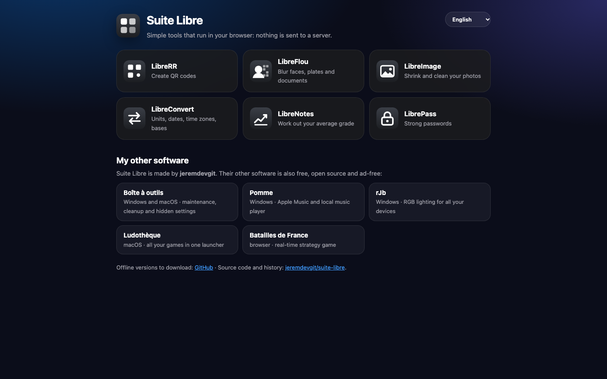

| Tool | What it does |
|---|---|
| [**LibreRR**](#librerr--qr-codes) | Create custom QR codes |
| [**LibreFlou**](#libreflou--blur-before-sharing) | Blur faces, license plates and documents before sharing |
| [**LibreImage**](#libreimage--shrink-and-clean-your-photos) | Shrink photos and strip their hidden information |
| [**LibreConvert**](#libreconvert--conversions) | Units, dates, time zones, number bases |
| [**LibreNotes**](#librenotes--grade-average) | Work out your average and the grade you need to pass |
| [**LibrePass**](#librepass--passwords) | Generate strong passwords and test your own |

---

## Using the tools

**Online**: <https://jeremdevgit.github.io/suite-libre/>

**Offline**: download the file for the tool you want from the [Releases](https://github.com/jeremdevgit/suite-libre/releases/latest) page (for example `LibreRR-hors-ligne.html`), then open it in your browser. It works without a connection on Windows, macOS, Linux, Android and iPhone.

To check that a downloaded file hasn't been tampered with, compare its hash with `SHA256SUMS.txt` (published with each release):

```sh
# macOS / Linux
shasum -a 256 -c SHA256SUMS.txt --ignore-missing
# Windows (PowerShell)
Get-FileHash .\LibreRR-hors-ligne.html -Algorithm SHA256
```

---

## The tools

### LibreRR — QR codes

A QR code for a link, a pre-filled email, text, a Wi-Fi network, a phone number, an SMS, a contact card or a location. Adjustable size, margin and error correction; colors, gradient, dot and corner shapes, logo in the center; export to PNG, SVG, JPEG or WEBP. Tips appear when the code might be hard to scan.

<p>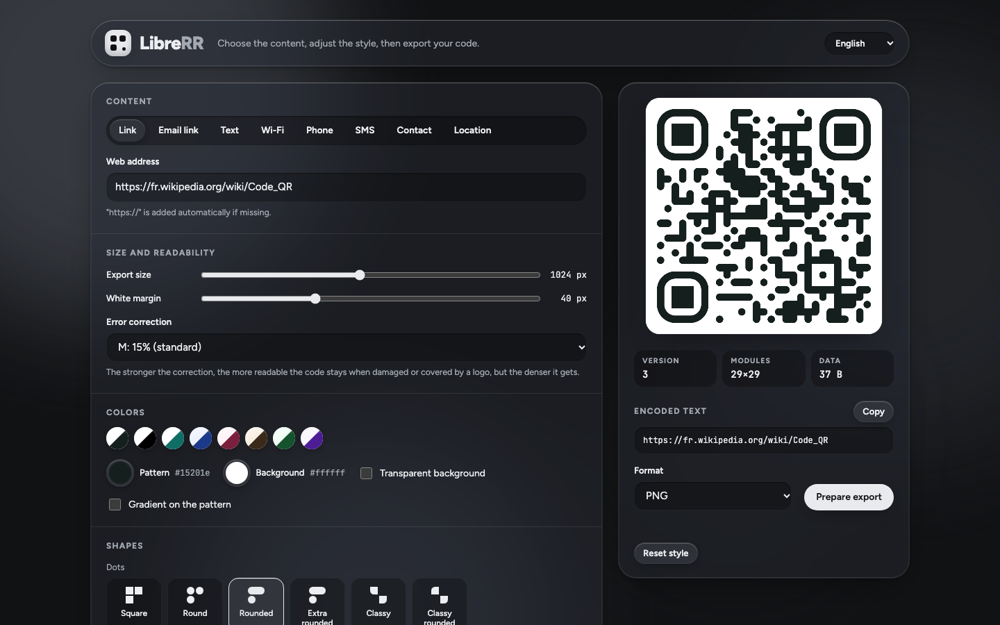 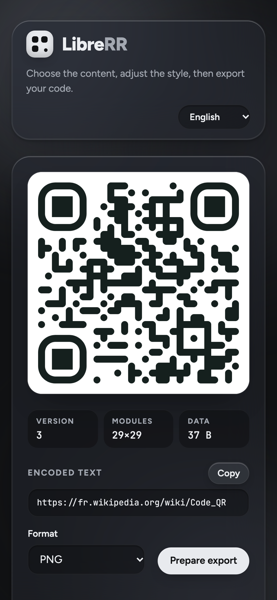</p>

### LibreFlou — blur before sharing

Hide what shouldn't be seen in a photo or screenshot: faces, license plates, addresses, document numbers. Rectangles, ellipses or brush, each area with a blur, pixelate or solid mask effect. Areas can be moved, resized and undone. The image is saved at its original size, **without GPS location or other hidden information**.

<p>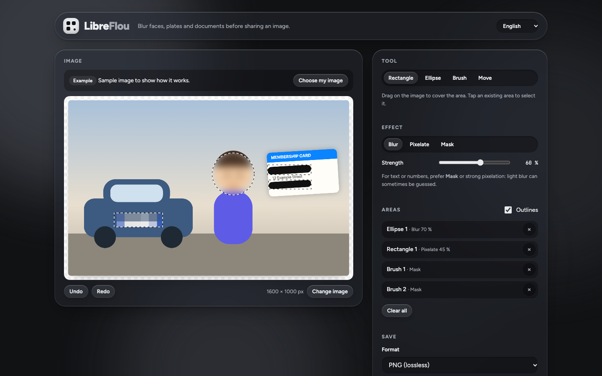 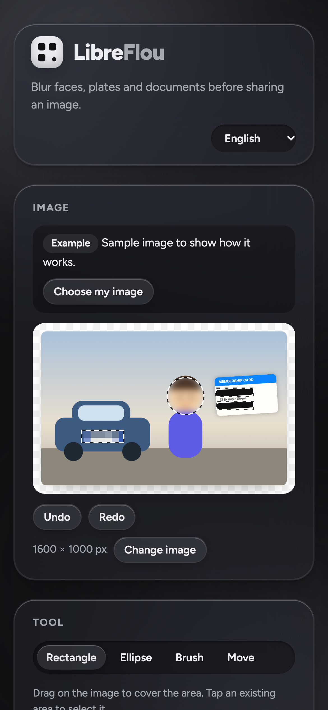</p>

### LibreImage — shrink and clean your photos

Drop your images: LibreImage makes them smaller (JPEG, WEBP or PNG, adjustable quality), resizes them if needed and **always strips** hidden information (GPS location, camera, date taken). The size saved and the information removed are shown for each image; download one by one or as a ZIP.

<p>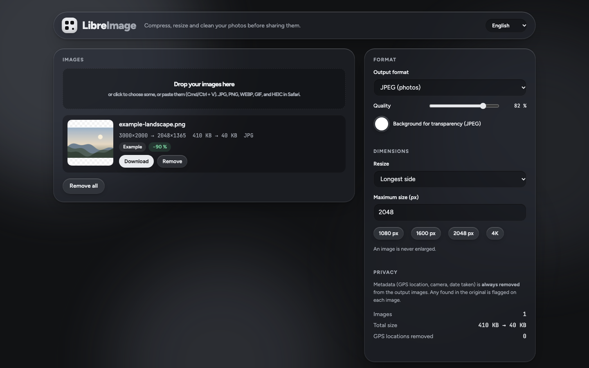 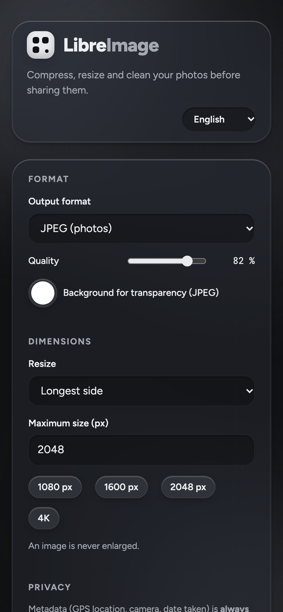</p>

### LibreConvert — conversions

Length, mass, temperature, volume, area, speed, digital data, duration, energy and pressure. Days, weeks and working days between two dates with French public holidays (Alsace-Moselle optional), adding or subtracting days, weeks or months, time in several time zones with daylight saving changes, conversion between decimal, binary, octal and hexadecimal.

<p>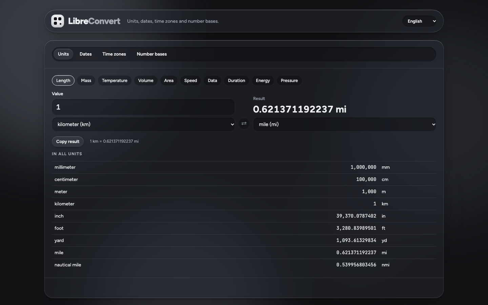 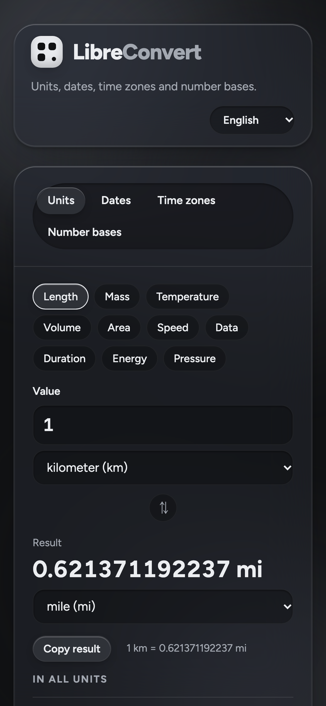</p>

### LibreNotes — grade average

Add your subjects and assessments with their coefficients: LibreNotes calculates each subject's average, the overall average and the honors level (French 0–20 scale). Leave upcoming assessments empty and it tells you the grade you need to reach your target. CSV export. Your grades stay in your browser.

<p>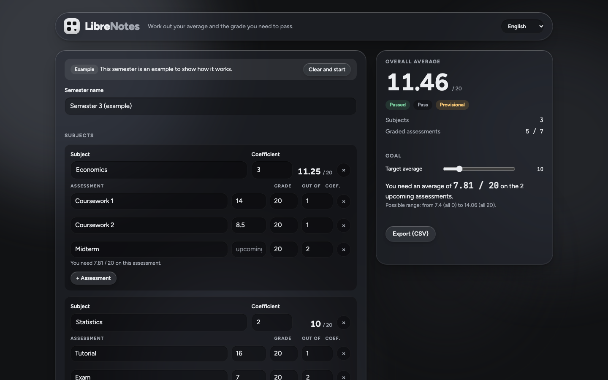 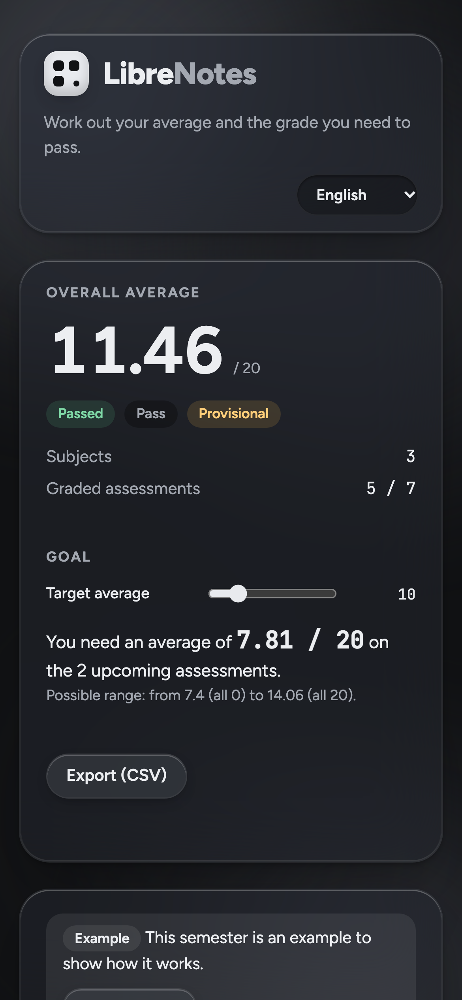</p>

### LibrePass — passwords

Generates truly random passwords (length, uppercase, digits, symbols, ambiguous characters avoided) or easy-to-remember passphrases (English words, French words in the French interface). It also tests your own passwords: estimated strength, time to crack and tips. Nothing is sent or saved.

<p>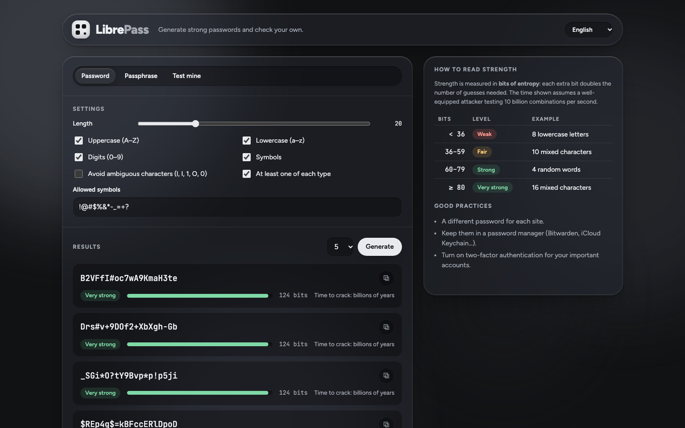 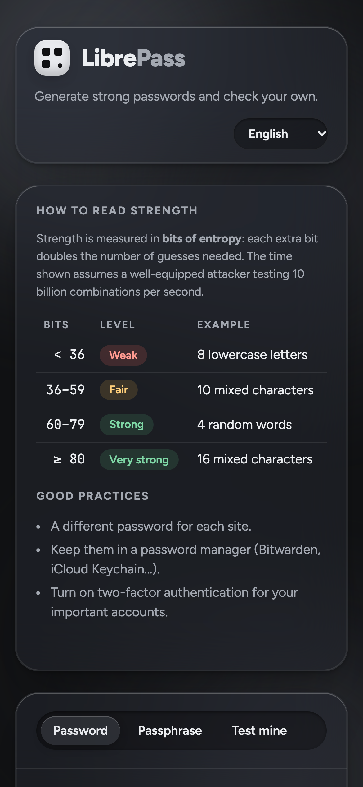</p>

---

## Privacy and security

- **No data ever leaves your device.** No application server, no cookies, no analytics, no fonts or scripts loaded from another site.
- **Strict Content Security Policy (CSP)** on every page: only the tool's own scripts can run, and no network connection is allowed outside the site itself. In the offline versions, each script is allowed by its **SHA-256 hash**: a modified file refuses to run.
- **LibrePass** draws characters with the browser's cryptographic generator (`crypto.getRandomValues`), without bias.
- **LibreImage and LibreFlou** produce images without metadata (GPS location, camera, date).
- All text displayed in the page is escaped: a file name or an input can't inject code.

Found a vulnerability? Please read [SECURITY.md](SECURITY.md) before opening a public issue.

---

## Building the offline versions

Python 3.8 or later is enough, with no dependencies:

```sh
python3 construire.py
```

The six standalone files and `SHA256SUMS.txt` are created in `dist/`. Each file embeds the tool's icon, fonts, scripts and translations.

## Hosting the suite

The tools are plain static pages: any file hosting works. For **GitHub Pages**: *Settings → Pages → Build and deployment → Deploy from a branch → `main` / `(root)`*. The home page is `index.html`; each tool lives in its own folder.

## Translations

`langue.js` picks the language (`?lang=` link, saved choice, then browser language) and translates the page once when it loads. Texts are in each folder's `textes.js`, where the French text is the key: to fix a translation or add a language, just edit that file.

## Repository layout

```
index.html, suite.css        suite home page
librerr/ … librepass/        one folder per tool (index.html, script, icon, fonts)
langue.js, */textes.js       language selection and translations
construire.py                builds the offline versions (dist/)
captures/                    screenshots (captures/en: English interface)
licences-tiers/              third-party licenses
```

## License

Code under the **GNU GPL v3 or later** — see [LICENSE](LICENSE). Copyright © 2026 jeremdevgit.

Bundled third-party components, under their own licenses (folder [licences-tiers](licences-tiers/)):

- [qr-code-styling](https://github.com/kozakdenys/qr-code-styling) — MIT license (LibreRR);
- [Figtree](https://github.com/erikdkennedy/figtree) and [JetBrains Mono](https://github.com/JetBrains/JetBrainsMono) fonts — SIL Open Font License 1.1.

## My other software

All free, open source and ad-free — [github.com/jeremdevgit](https://github.com/jeremdevgit):

| Software | For | In short |
|---|---|---|
| [Carnet Rust](https://github.com/jeremdevgit/carnet-rust) | Windows | encrypted local notes and experimental Joplin/Nextcloud sync · [download ZIP](https://github.com/jeremdevgit/carnet-rust/releases/latest) |
| [JMeca](https://github.com/jeremdevgit/jmeca) | Windows, macOS, Linux | encrypted vehicle maintenance, client folders, service log and fuel tracking |
| [Boîte à outils](https://github.com/jeremdevgit/boite-a-outils) | Windows, macOS | maintenance, cleanup and hidden settings |
| [Pomme](https://github.com/jeremdevgit/pomme) | Windows | Apple Music and local music player |
| [rJb](https://github.com/jeremdevgit/rjb) | Windows | RGB lighting for all your devices in one app |
| [Ludothèque](https://github.com/jeremdevgit/ludotheque) | macOS | all your games in one launcher |
| [Batailles de France](https://github.com/jeremdevgit/batailles-de-france) | browser | real-time strategy game on the maps of five French cities |
