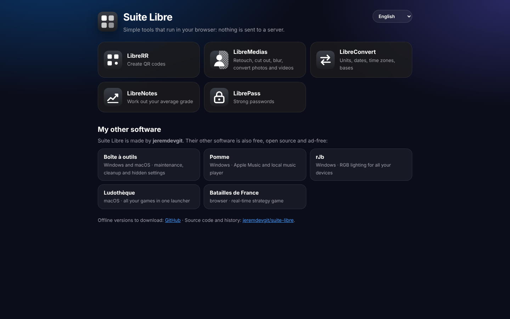
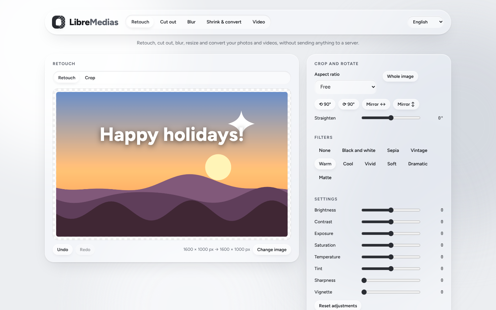
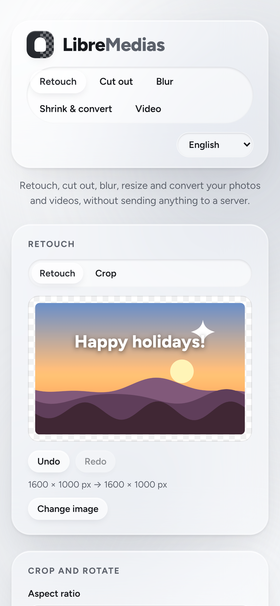

<p align="center"></p>

<h1 align="center">Suite Libre</h1>

<p align="center"><b>Five everyday tools in your browser, with no account and no tracking: QR codes, photos and videos (retouch, background removal, blur, resize, convert), conversions, grades, passwords.</b></p>

<p align="center"> <a href="https://github.com/jeremdevgit/suite-libre/releases"></a> <a href="LICENSE"></a></p>

<p align="center"><b>English</b> · <a href="README.fr.md">Français</a> · <a href="README.es.md">Español</a> · <a href="README.de.md">Deutsch</a> · <a href="README.it.md">Italiano</a> · <a href="README.pt.md">Português</a> · <a href="README.zh.md">简体中文</a> · <a href="README.ja.md">日本語</a></p>

<p align="center"><a href="https://jeremdevgit.github.io/suite-libre/"><b>▶ Open in your browser</b></a> · <a href="https://github.com/jeremdevgit/suite-libre/releases/latest">Download</a></p>



Every tool runs **entirely in your browser**: nothing is sent to a server. Each one also comes as an **offline version**, a single HTML file you open with a double-click on Windows, macOS, Linux, Android or iPhone.

## At a glance

| | |
|---|---|
| **Category** | 📒 Productivity & data |
| **Platforms** | Browser |
| **Interface** | 8 languages (EN, FR, ES, DE, IT, PT, ZH, JA) |
| **Price** | Free, open source, no ads, no telemetry |
| **Status** | Stable |
| **License** | [GPL-3.0-or-later](LICENSE) |

## The tools

| Tool | What it does |
|---|---|
| **LibreRR** | QR codes for links, email, text, Wi-Fi, phone, SMS, contact cards or places; colors, gradients, shapes, logo; PNG, SVG, JPEG or WEBP export |
| **LibreMedias** | All-in-one photo and video tool. **Retouch**: crop, rotate, straighten, flip, light/contrast/color/sharpness, filters, text, built-in pictogram library and your own logos, watermark, size in pixels. **Cut out**: JPEG to transparent PNG, automatic subject, frame, plain/green background, brush and magic wand, new background, shadow, sticker outline, batch ZIP. **Blur** faces, plates and documents. **Shrink and convert** images in batches. **Video**: green screen or fixed camera, crop, size in px, trim, WEBM/MP4, animated GIF or PNG/JPEG sequence. Exports to PNG, JPEG, WEBP, AVIF, GIF, BMP, TIFF, ICO, PDF; **always without** location, camera and date |
| **LibreConvert** | Units, days between dates (with French public holidays), time zones, decimal/binary/octal/hex |
| **LibreNotes** | Subject and overall averages with coefficients (French 0–20 scale), the grade you need to reach a target, CSV export |
| **LibrePass** | Truly random passwords or memorable passphrases, and a strength test for your own |

<p> </p>
<p> </p>

## Use it

- **Online**: <https://jeremdevgit.github.io/suite-libre/>
- **Offline**: download a tool from the [latest release](https://github.com/jeremdevgit/suite-libre/releases/latest) (for example `LibreRR-hors-ligne.html`) and open it.
- **Verify** a download: `shasum -a 256 -c SHA256SUMS.txt --ignore-missing` (macOS/Linux) or `Get-FileHash` (Windows).

## Your data

- **Nothing leaves your device**: no server, cookies, analytics, or fonts and scripts from other sites.
- A **strict Content Security Policy** on every page blocks any outside connection; offline files allow each script by its **SHA-256 hash**, so a modified file refuses to run.
- LibrePass uses the browser's cryptographic generator (`crypto.getRandomValues`) without bias; LibreMedias outputs images with no metadata.

## Build and host

```sh
python3 construire.py      # Python 3.8+, no dependencies → dist/ (5 offline files + SHA256SUMS.txt)
```

The tools are static pages, so any host works; for GitHub Pages choose *Deploy from a branch → `main` / root*. Texts live in each folder's `textes.js`, with the French text as key.

## License

GNU GPL v3 or later — see [LICENSE](LICENSE). Bundled [qr-code-styling](https://github.com/kozakdenys/qr-code-styling) (MIT) and the [Figtree](https://github.com/erikdkennedy/figtree) and [JetBrains Mono](https://github.com/JetBrains/JetBrainsMono) fonts (OFL 1.1), see [`licences-tiers/`](licences-tiers/).

---

Found a vulnerability? Please report it privately (see [SECURITY.md](SECURITY.md)) rather than in a public issue.

## More free software by jeremdevgit

All free, open source and ad-free.

**🛠️ System & hardware** — [Boîte à outils](https://github.com/jeremdevgit/boite-a-outils) · [rJb](https://github.com/jeremdevgit/rjb) · [LJ Hub](https://github.com/jeremdevgit/lj-hub) · [Decklight](https://github.com/jeremdevgit/decklight)

**📒 Productivity & data** — [Carnet de notes](https://github.com/jeremdevgit/carnet-rust) · [JMeca](https://github.com/jeremdevgit/jmeca)

**🎮 Music & games** — [Pomme](https://github.com/jeremdevgit/pomme) · [Ludothèque](https://github.com/jeremdevgit/ludotheque) · [AutoDex](https://github.com/jeremdevgit/autodex) · [Batailles de France](https://github.com/jeremdevgit/batailles-de-france)
