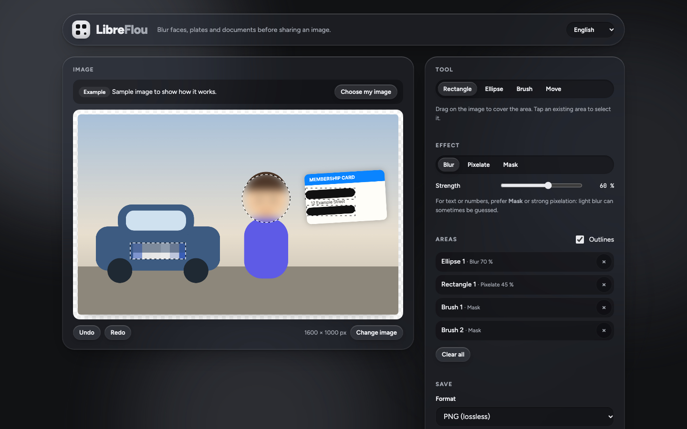
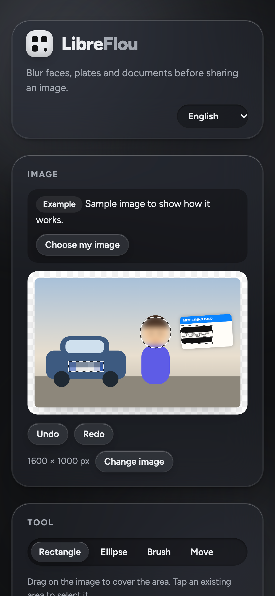
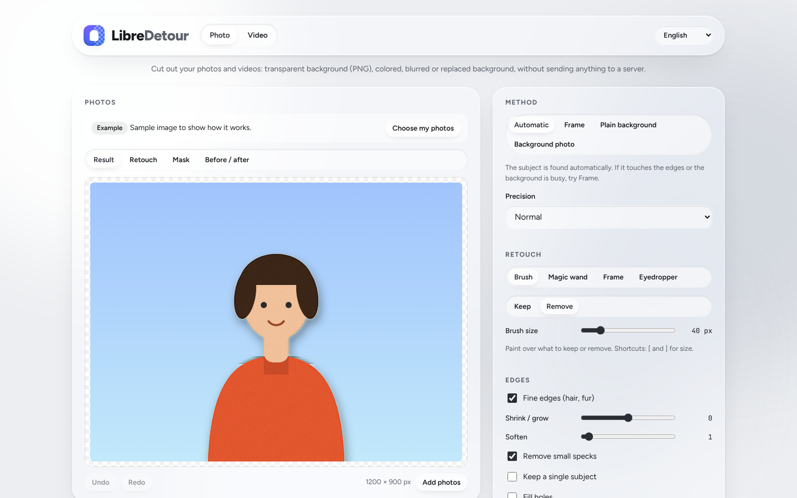
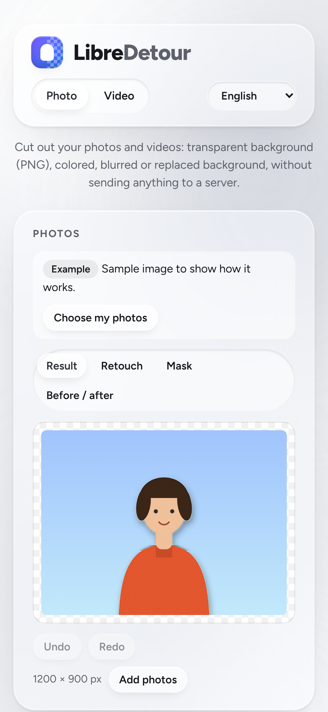

<p align="center"></p>

<h1 align="center">Suite Libre</h1>

<p align="center"><b>Sete ferramentas do dia a dia no navegador, sem conta nem rastreio: códigos QR, desfocagem, recorte de fundo, fotos, conversões, médias, palavras-passe.</b></p>

<p align="center"> <a href="https://github.com/jeremdevgit/suite-libre/releases"></a> <a href="LICENSE"></a></p>

<p align="center"><a href="README.md">English</a> · <a href="README.fr.md">Français</a> · <a href="README.es.md">Español</a> · <a href="README.de.md">Deutsch</a> · <a href="README.it.md">Italiano</a> · <b>Português</b> · <a href="README.zh.md">简体中文</a> · <a href="README.ja.md">日本語</a></p>

<p align="center"><a href="https://jeremdevgit.github.io/suite-libre/"><b>▶ Abrir no navegador</b></a> · <a href="https://github.com/jeremdevgit/suite-libre/releases/latest">Transferir</a></p>


Cada ferramenta funciona **inteiramente no seu navegador**: nada é enviado para um servidor. Todas existem também em **versão offline**, um único ficheiro HTML que se abre com um duplo clique no Windows, macOS, Linux, Android ou iPhone.

## Em resumo

| | |
|---|---|
| **Categoria** | 📒 Produtividade e dados |
| **Plataformas** | Navegador |
| **Interface** | 8 idiomas (EN, FR, ES, DE, IT, PT, ZH, JA) |
| **Preço** | Gratuito, de código aberto, sem anúncios nem telemetria |
| **Estado** | Estável |
| **Licença** | [GPL-3.0-or-later](LICENSE) |

## As ferramentas

| Ferramenta | Para que serve |
|---|---|
| **LibreRR** | Códigos QR para ligações, e-mail, texto, Wi-Fi, telefone, SMS, cartões de contacto ou locais; cores, gradientes, formas, logótipo; exportação PNG, SVG, JPEG ou WEBP |
| **LibreFlou** | Desfocar, pixelizar ou tapar rostos, matrículas e documentos antes de partilhar; guardado em tamanho real **sem GPS nem dados ocultos** |
| **LibreImage** | Reduzir fotos (JPEG, WEBP, PNG), redimensioná-las e **remover sempre** local, câmara e data; uma a uma ou em ZIP |
| **LibreDetour** | Remover o fundo de fotos e vídeos: **JPEG para PNG transparente**, assunto automático, moldura, fundo liso ou verde, ou foto do fundo; pincel e varinha; novo fundo (cor, degradê, desfoque, preto e branco, imagem), sombra, contorno de autocolante, enquadramento quadrado ou story; lote em ZIP. Vídeos: fundo verde ou câmara fixa (fundo calculado automaticamente), WEBM ou sequência PNG transparente |
| **LibreConvert** | Unidades, dias entre datas (com feriados franceses), fusos horários, decimal/binário/octal/hexadecimal |
| **LibreNotes** | Médias por disciplina e geral com coeficientes (escala francesa 0–20), nota necessária para um objetivo, exportação CSV |
| **LibrePass** | Palavras-passe realmente aleatórias ou frases fáceis de lembrar, e um teste de robustez para as suas |

<p> </p>
<p> </p>
<p> </p>

## Usar

- **Online**: <https://jeremdevgit.github.io/suite-libre/>
- **Offline**: transfira uma ferramenta da [versão mais recente](https://github.com/jeremdevgit/suite-libre/releases/latest) (por exemplo `LibreRR-hors-ligne.html`) e abra-a.
- **Verificar** uma transferência: `shasum -a 256 -c SHA256SUMS.txt --ignore-missing` (macOS/Linux) ou `Get-FileHash` (Windows).

## Os seus dados

- **Nada sai do seu dispositivo**: sem servidor, cookies, estatísticas, nem tipos de letra ou scripts de outros sites.
- Uma **política de segurança de conteúdo (CSP) estrita** em cada página bloqueia qualquer ligação externa; nos ficheiros offline cada script é autorizado pelo seu **hash SHA-256**, por isso um ficheiro alterado recusa-se a correr.
- O LibrePass usa o gerador criptográfico do navegador (`crypto.getRandomValues`) sem enviesamento; o LibreImage, o LibreFlou e o LibreDetour produzem imagens sem metadados.

## Compilar e alojar

```sh
python3 construire.py      # Python 3.8+, sem dependências → dist/ (7 ficheiros offline + SHA256SUMS.txt)
```

As ferramentas são páginas estáticas, por isso qualquer alojamento serve; no GitHub Pages escolha *Deploy from a branch → `main` / raiz*. Os textos estão no `textes.js` de cada pasta, com o texto francês como chave.

## Licença

GNU GPL v3 ou posterior — ver [LICENSE](LICENSE). Inclui [qr-code-styling](https://github.com/kozakdenys/qr-code-styling) (MIT) e os tipos de letra [Figtree](https://github.com/erikdkennedy/figtree) e [JetBrains Mono](https://github.com/JetBrains/JetBrainsMono) (OFL 1.1), ver [`licences-tiers/`](licences-tiers/).

---

Encontrou uma vulnerabilidade? Comunique-a em privado (consulte [SECURITY.md](SECURITY.md)) e não num issue público.

## Mais software livre de jeremdevgit

Todos gratuitos, de código aberto e sem anúncios.

**🛠️ Sistema e hardware** — [Boîte à outils](https://github.com/jeremdevgit/boite-a-outils) · [rJb](https://github.com/jeremdevgit/rjb) · [LJ Hub](https://github.com/jeremdevgit/lj-hub) · [Decklight](https://github.com/jeremdevgit/decklight)

**📒 Produtividade e dados** — [Carnet de notes](https://github.com/jeremdevgit/carnet-rust) · [JMeca](https://github.com/jeremdevgit/jmeca)

**🎮 Música e jogos** — [Pomme](https://github.com/jeremdevgit/pomme) · [Ludothèque](https://github.com/jeremdevgit/ludotheque) · [AutoDex](https://github.com/jeremdevgit/autodex) · [Batailles de France](https://github.com/jeremdevgit/batailles-de-france)
