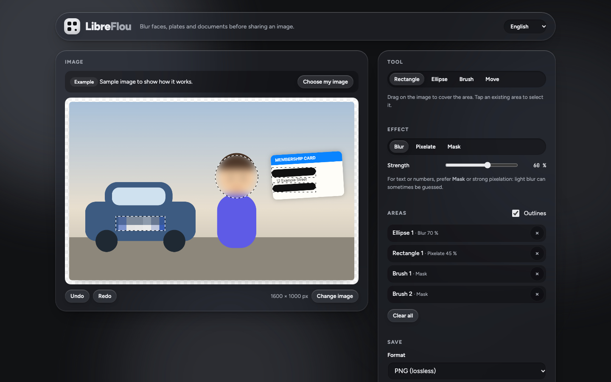
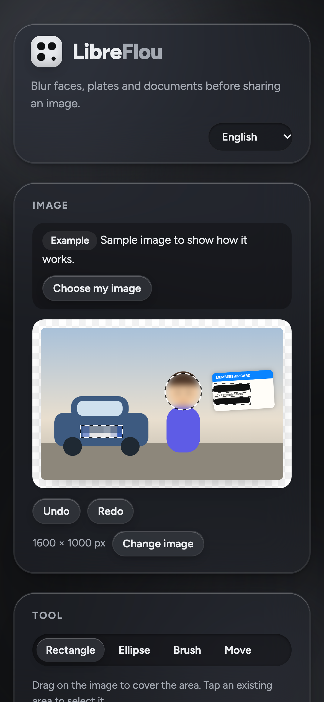

<p align="center"></p>

<h1 align="center">Suite Libre</h1>

<p align="center"><b>浏览器里的六个日常工具，无需账号、无追踪：二维码、打码、图片压缩、单位换算、成绩平均、密码。</b></p>

<p align="center"> <a href="https://github.com/jeremdevgit/suite-libre/releases"></a> <a href="LICENSE"></a></p>

<p align="center"><a href="README.md">English</a> · <a href="README.fr.md">Français</a> · <a href="README.es.md">Español</a> · <a href="README.de.md">Deutsch</a> · <a href="README.it.md">Italiano</a> · <a href="README.pt.md">Português</a> · <b>简体中文</b> · <a href="README.ja.md">日本語</a></p>

<p align="center"><a href="https://jeremdevgit.github.io/suite-libre/"><b>▶ 在浏览器中打开</b></a> · <a href="https://github.com/jeremdevgit/suite-libre/releases/latest">下载</a></p>


每个工具都**完全在浏览器中运行**：不向任何服务器发送数据。每个工具也都有**离线版**——一个 HTML 文件，在 Windows、macOS、Linux、Android 或 iPhone 上双击即可打开。

## 概览

| | |
|---|---|
| **类别** | 📒 效率与数据 |
| **平台** | 浏览器 |
| **界面语言** | 8 种语言（英、法、西、德、意、葡、中、日） |
| **价格** | 免费、开源、无广告、无遥测 |
| **状态** | 稳定版 |
| **许可证** | [GPL-3.0-or-later](LICENSE) |

## 工具一览

| 工具 | 用途 |
|---|---|
| **LibreRR** | 为链接、邮件、文本、Wi-Fi、电话、短信、名片或位置生成二维码；颜色、渐变、形状、中心 Logo；导出 PNG、SVG、JPEG 或 WEBP |
| **LibreFlou** | 分享前对人脸、车牌和证件进行模糊、马赛克或遮挡；按原尺寸保存，**不含 GPS 和隐藏信息** |
| **LibreImage** | 压缩照片（JPEG、WEBP、PNG）、调整尺寸，并**始终移除**位置、相机和拍摄时间；可单张下载或打包 ZIP |
| **LibreConvert** | 单位换算、日期间隔（含法国节假日）、时区、十进制/二进制/八进制/十六进制 |
| **LibreNotes** | 按系数计算各科和总平均分（法国 0–20 分制），算出达到目标所需分数，导出 CSV |
| **LibrePass** | 生成真正随机的密码或易记的密码短语，并检测你自己密码的强度 |

<p> </p>
<p> </p>

## 使用

- **在线**：<https://jeremdevgit.github.io/suite-libre/>
- **离线**：从[最新版本](https://github.com/jeremdevgit/suite-libre/releases/latest)下载所需工具（例如 `LibreRR-hors-ligne.html`）并打开。
- **校验**下载文件：`shasum -a 256 -c SHA256SUMS.txt --ignore-missing`（macOS/Linux）或 `Get-FileHash`（Windows）。

## 你的数据

- **数据从不离开你的设备**：没有服务器、Cookie、统计，也不加载其他网站的字体或脚本。
- 每个页面都有**严格的内容安全策略（CSP）**，阻止一切外部连接；离线文件中的每个脚本都通过其 **SHA-256 哈希**授权，文件被改动后将拒绝运行。
- LibrePass 使用浏览器的加密随机数生成器（`crypto.getRandomValues`），无偏差；LibreImage 和 LibreFlou 输出的图片不含元数据。

## 构建与托管

```sh
python3 construire.py      # Python 3.8+，无依赖 → dist/（6 个离线文件 + SHA256SUMS.txt）
```

这些工具都是静态页面，任何托管方式都可以；GitHub Pages 请选择 *Deploy from a branch → `main` / 根目录*。文本位于各文件夹的 `textes.js`，以法语文本为键。

## 许可证

GNU GPL v3 或更高版本，见 [LICENSE](LICENSE)。附带 [qr-code-styling](https://github.com/kozakdenys/qr-code-styling)（MIT）以及 [Figtree](https://github.com/erikdkennedy/figtree) 和 [JetBrains Mono](https://github.com/JetBrains/JetBrainsMono) 字体（OFL 1.1），见 [`licences-tiers/`](licences-tiers/)。

---

发现安全漏洞？请私下报告（见 [SECURITY.md](SECURITY.md)），不要发公开 issue。

## jeremdevgit 的其他自由软件

全部免费、开源、无广告。

**🛠️ 系统与硬件** — [Boîte à outils](https://github.com/jeremdevgit/boite-a-outils) · [rJb](https://github.com/jeremdevgit/rjb) · [LJ Hub](https://github.com/jeremdevgit/lj-hub) · [Decklight](https://github.com/jeremdevgit/decklight)

**📒 效率与数据** — [Carnet de notes](https://github.com/jeremdevgit/carnet-rust) · [JMeca](https://github.com/jeremdevgit/jmeca)

**🎮 音乐与游戏** — [Pomme](https://github.com/jeremdevgit/pomme) · [Ludothèque](https://github.com/jeremdevgit/ludotheque) · [AutoDex](https://github.com/jeremdevgit/autodex) · [Batailles de France](https://github.com/jeremdevgit/batailles-de-france)
